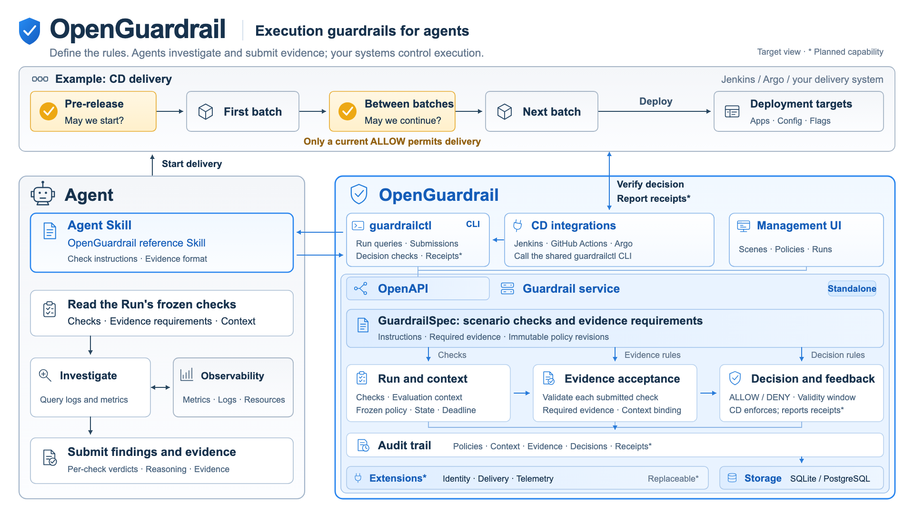

# OpenGuardrail

English | [简体中文](docs/i18n/README.zh-CN.md)

**Evidence-based action guardrails for AI agents.**

OpenGuardrail is a standalone guardrail service for AI agents that operate real
systems.

Developers define the checks required before an action. The agent follows the
policy, performs the checks and submits results and evidence. OpenGuardrail
validates the submission, records the assessment and returns `ALLOW` or `DENY`.
The execution tool verifies the decision and its validity before acting.

Each assessment links the policy revision, check results, evidence and decision
for verification and audit. Agents and tools use the HTTP API or the
`guardrailctl` CLI.

**Status: development preview.** The API is `v1alpha1`. See
[current capabilities and limits](#current-capabilities-and-limits) for details.

[Source](https://github.com/alibaba/open-guardrail) · [Issues](https://github.com/alibaba/open-guardrail/issues) ·
[Get started](docs/getting-started.md) · [Documentation](docs/README.md) · [API and CLI](docs/api.md) ·
[Deployment](docs/configuration.md) · [Contributing](CONTRIBUTING.md) ·
[Apache-2.0](LICENSE)

## Why OpenGuardrail?

When an agent has permission to operate real systems, required checks need to
be enforced at execution time. Prompts can tell the agent to check first, but
execution tools still need a verifiable basis for allowing an action. Audits
also need a clear record of the policy, check results and evidence used at the
time.

If that information lives only in agent conversations and tool logs, each
execution tool must extract and correlate it before deciding whether to proceed.
OpenGuardrail organizes it into a consistent assessment record for tools to
verify before acting and for later audits.

## Scenarios

Each business operation defines its own requirements. For example:

| Operation | Example checks |
| --- | --- |
| Release an application | Required tests pass; the release target matches the request |
| Change configuration | The change scope meets the policy; required approvals are recorded in an existing system |
| Modify data | Target resources and expected impact are within allowed bounds |

These policy examples depend on external observation and execution integrations.
The agent uses connected tools to perform checks and collect evidence. The
execution tool enforces the decision at the point of action.

A **Scene** groups the policies for a use case. Scenes share the same policy,
evidence and decision model, so new scenarios can be added without changing the
service's core API.

## How it works

```text
Policy checks defined per operation
                       |
The agent performs checks with its tools
and submits check results and evidence
                       |
OpenGuardrail validates the submission, records the assessment
and returns ALLOW / DENY
                       |
The execution tool verifies the decision and evidence before acting
```

1. **Publish a policy.** Define checks and evidence requirements in a GuardrailSpec
   and publish an immutable revision, then activate it for the Scene.
2. **Start an assessment.** Create a Run to record the operation's context and freeze
   the selected policy revision and evaluation deadline.
3. **Check and submit.** The agent reads the Run's policy requirements, performs
   the checks with its tools, and submits complete results and evidence.
   Intermediate snapshots can precede a final submission.
4. **Read the decision.** Query the authoritative Run for its stored decision and
   validity, then read its referenced Submission to inspect the evidence.
5. **Verify before acting.** The execution tool checks the authoritative decision,
   its validity and the evidence, then applies business rules before acting.

For a completed Run, the check results aggregate as follows:

| Result | Meaning | Decision |
| --- | --- | --- |
| `PASS` | All checks pass | `ALLOW` |
| `BLOCKED` | At least one check reports a confirmed failure | `DENY` |
| `UNKNOWN` | No check is blocked, but at least one cannot be assessed | `DENY` |

An unfinished Run can expire, and a completed decision has its own validity
window. Integrations must check the authoritative Run, its deadline and decision
validity. See [Runs and submissions](docs/runs.md).

## Quickstart

Run a file cleanup task and watch a guarded tool act on real files in a disposable
directory. This trial needs no model account, Jenkins, Docker or separate database.

### Run a guarded task

If you have a native archive from [GitHub Releases](https://github.com/alibaba/open-guardrail/releases),
follow [archive verification](docs/releases.md#check-and-try-a-downloaded-archive),
extract it and run the demo command below from its extraction root. The demo
needs Python 3.9+; the packaged binaries need no Go or Node.js.

From source, install Git, the Go version specified in `go.mod` and Python 3.9+:

```sh
git clone https://github.com/alibaba/open-guardrail.git
cd open-guardrail
python3 examples/cleanup-demo/demo.py
```

Choose a console password at the hidden prompts. The script builds both commands
from source or uses the archive's binaries, then prints a **Demo** URL and a
**Console** URL. Open the Demo first; it needs no login.

Click **Run cleanup task**. The initial request includes temporary files, orders
and configuration. A predefined runner submits the observed file state and gets
a real `DENY`. It narrows the request, creates another Run and gets `ALLOW`.
The controlled tool verifies that Run and its evidence before deleting only the
temporary files. Orders and configuration remain on disk.

Change the selected files, disable automatic revision or lower the batch limit,
then run again. Expand a Run to inspect its frozen policy and accepted evidence.
The runner uses no model; the service calls and file operations are real.
See the [demo guide](examples/cleanup-demo/README.md) for the workflow and limits.

Keep the terminal open. Ctrl-C stops both services and removes their temporary
data and credentials. The separate Console uses username `demo` and the password
chosen at startup; its **Runs** page contains the same Run IDs. For the original
four-case Recovery contract self-check, run
`python3 examples/agent-demo/smoke.py`.

### Start a persistent service

To keep a service running and inspect your own Runs in the browser, use Go and
Make from the checkout root:

```sh
make build
./bin/open-guardrail serve
```

Open <http://127.0.0.1:8080> and create the first administrator. There is no default
password. SQLite stores data in `./data`; no separate database service is needed.

### Next steps

| Goal | Guide |
| --- | --- |
| Understand how a policy affects a decision | [Getting started](docs/getting-started.md): publish a policy, submit an assessment and inspect its evidence |
| Have an agent perform the checks | [Agent demo](examples/agent-demo/README.md): let an agent assess the sample observations and submit its findings |
| Protect an operation in my own tool | [Integration guide](integrations/README.md) and [API and CLI](docs/api.md): define the checks, connect observation sources and verify the decision in your execution tool |

## Target architecture

The target architecture below uses CD delivery as one example of the shared
guardrail model. An agent follows a Scene's checks and submits evidence;
OpenGuardrail validates the submission and records a decision; the execution tool
verifies the decision and evidence before acting. Blue components belong to
OpenGuardrail; gray components represent the agent and external systems.

[](docs/images/target-architecture.svg)

*Open the diagram for the full-size SVG. Execution Claims and receipts,
replaceable providers, and some CD integrations remain planned. The server
validates evidence structure and completeness; the calling system verifies the
observations. See [current capabilities and limits](#current-capabilities-and-limits)
and [reference integrations](#reference-integrations) for what works today.*

## Current capabilities and limits

The preview includes:

- A standalone Go service, an HTTP CLI and an embedded management UI.
- Local administrator setup, browser/CLI sessions and scoped machine credentials
  with bounded lifetimes, metadata listing, secret rotation and revocation.
- Scenes, editable policy drafts and immutable policy revisions.
- Runs with frozen policy/evaluation context, intermediate and final submissions,
  structured evidence, expiry and stored decisions.
- SQLite and PostgreSQL adapters, with one service instance per database.
- Native packaging for Linux and macOS on amd64 and arm64, plus optional Docker
  deployment behind HTTPS.

The current boundaries are:

- Checks run outside the service, in your agent or integration. The server does
  not independently verify submitted observations. Registration and attestation
  of external evaluators are not implemented.
- Applying a decision and controlling actions belong to the calling system.
  Execution Claims and ActionResults remain planned.
- Multi-instance operation and replaceable identity/provider APIs are not yet
  supported.
- Alpha APIs and storage contracts may change during the preview.

See the [roadmap](docs/development-roadmap.md), [runtime architecture](docs/architecture.md)
and [security policy](SECURITY.md) for details.

## Reference integrations

Use the versioned [HTTP/OpenAPI contract](api/openapi/openapi.yaml) or the
[shared CLI](cmd/guardrailctl/README.md) to connect an application, service,
script or agent. The examples cover local file operations and delivery workflows.

| Integration | Current status |
| --- | --- |
| [Live file cleanup demo](examples/cleanup-demo/README.md) | Real Runs and guarded deletion in a disposable directory; predefined runner without a model |
| [Local Recovery Agent demo](examples/agent-demo/README.md) | Synthetic observations; agent-driven assessment and a deterministic self-check |
| [Jenkins](integrations/jenkins/README.md) | Synthetic pipeline demo with an outside agent and delivery-side evidence verification |
| [Argo Rollouts](integrations/argo/README.md) | Synthetic Analysis Job demo |
| [GitHub Actions](integrations/github-actions/README.md) | Planned adopter-facing workflow |
| [Argo CD](integrations/argo/README.md) | Sync hooks planned |

These examples demonstrate integration contracts. See the
[integration guide](integrations/README.md) for their scope and prerequisites.

## Documentation

Start with the [documentation index](docs/README.md) for reading paths, or read
[core concepts](docs/concepts.md) for the Scene, Policy, Run and Submission model.

| I want to… | Start here |
| --- | --- |
| Run a local example and inspect a decision | [Getting started](docs/getting-started.md) |
| Configure storage or a remote service | [Configuration and storage](docs/configuration.md), [Docker deployment](docs/docker.md) |
| Manage administrators and credentials | [Administrator guide](docs/local-administrator.md) |
| Author and publish a policy | [Scenes and Specs](docs/scenes-and-specs.md) |
| Create Runs and submit evidence | [Runs and submissions](docs/runs.md) |
| Call the API or automate with the CLI | [API overview](docs/api.md), [CLI guide](cmd/guardrailctl/README.md) |
| Understand the implementation or extension plans | [Architecture](docs/architecture.md), [extension boundaries](docs/extensions.md) |
| Build, contribute or prepare a release | [Development](docs/development.md), [release notes](docs/release-notes.md), [release verification](docs/releases.md) |

## Contributing and support

Bug reports, documentation improvements, integration feedback and focused code
changes are welcome. Read [CONTRIBUTING.md](CONTRIBUTING.md) for setup, issue
guidance and the pull request workflow.

Use [GitHub Issues](https://github.com/alibaba/open-guardrail/issues) for questions
and reproducible bug reports. Include your version and a minimal example with synthetic data.
Report vulnerabilities privately through [SECURITY.md](SECURITY.md). Community
participation follows our [Code of Conduct](CODE_OF_CONDUCT.md).

## License

OpenGuardrail is licensed under the [Apache License 2.0](LICENSE). Third-party
components retain their original terms; see the [notice inventory](third_party/README.md)
and [dependency review](docs/dependency-licenses.md).
