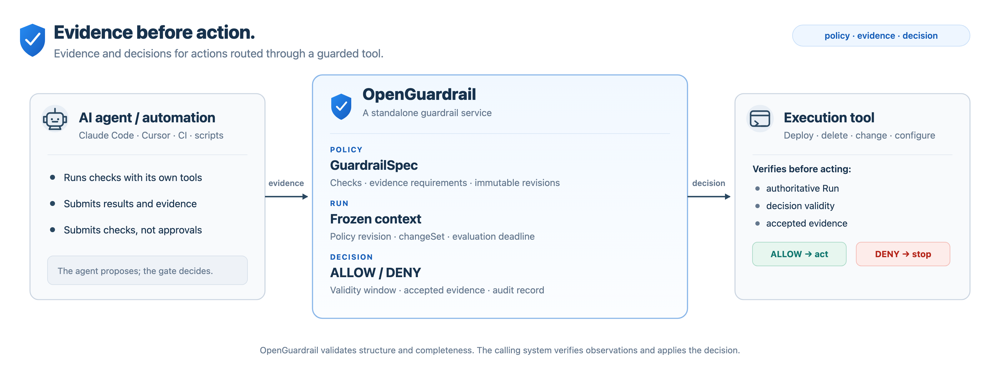
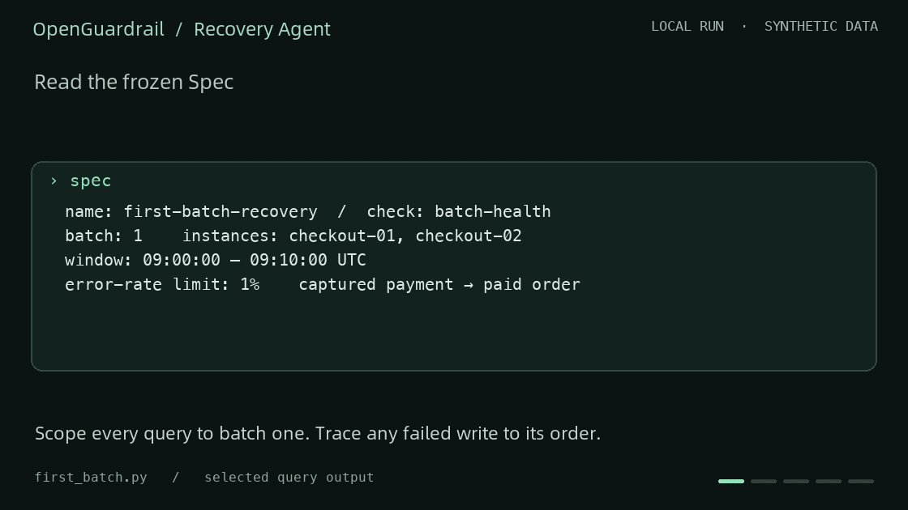
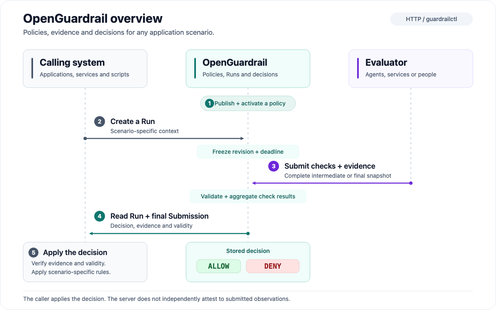
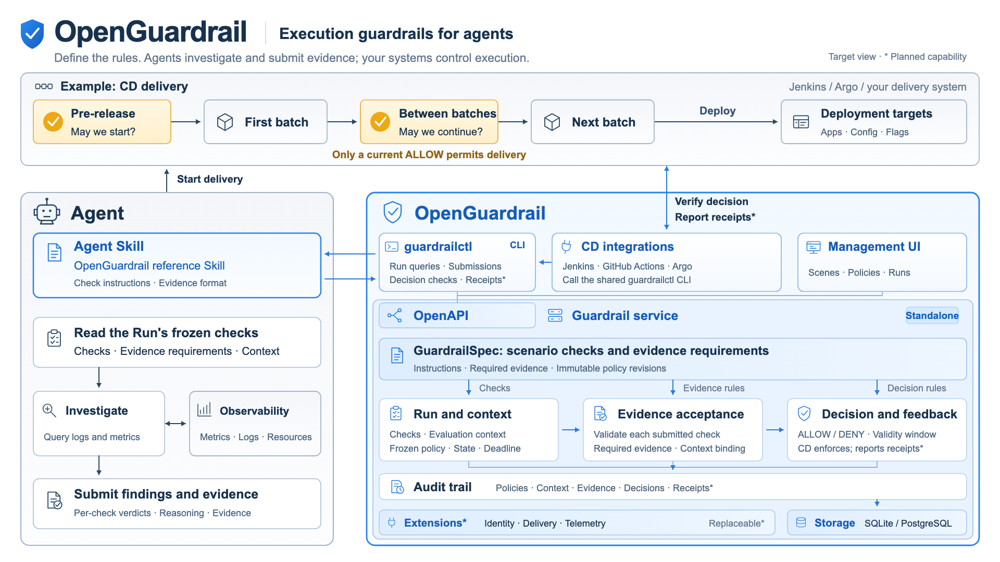

<div align="center">


# OpenGuardrail

English | [简体中文](docs/i18n/README.zh-CN.md)

### Evidence-based action guardrails for AI agents

[](go.mod)
[](LICENSE)

[See it in action](#see-it-in-action) · [Quickstart](#quickstart) · [How it works](#how-it-works) · [Reference integrations](#reference-integrations)

</div>

## Overview

Don't rely on system prompts alone to stop risky AI agent actions.
**OpenGuardrail** puts an evidence-based admission gate in front of destructive
MCP tool calls, database mutations, and production rollouts.

Developers define the checks required before an action in a versioned Spec. The
agent investigates, performs the checks, and submits structured evidence.
OpenGuardrail validates the submission, records an auditable `ALLOW` or `DENY`
decision with a bounded validity window, and the execution tool or proxy
verifies that decision before acting.

[](docs/images/readme-hero.svg)

*The agent proposes; the gate decides. Currently in `v1alpha1` development
preview — see [current capabilities and limits](#current-capabilities-and-limits).*

[Source](https://github.com/alibaba/open-guardrail) · [Issues](https://github.com/alibaba/open-guardrail/issues) ·
[Get started](docs/getting-started.md) · [Documentation](docs/README.md) · [API and CLI](docs/api.md) ·
[Deployment](docs/configuration.md) · [Contributing](CONTRIBUTING.md) ·
[Apache-2.0](LICENSE)

## See it in action

**The first batch is live. Can the next batch proceed?**

Production rollouts happen in batches. Once the first batch is live, the on-call engineer checks its metrics, error logs and alerts before deciding whether to roll out the second batch. At Alibaba, we already use OpenGuardrail for this check in production.

The local walkthrough uses synthetic data for a `checkout` service rollout. The new version changes how an order is marked as paid after payment is captured. The application owner writes the release criteria into the Spec. Alongside metrics and alerts, the agent must check the error logs from the first batch. If an order write fails, it checks whether the rollout changed the failing code, then looks up the order ID from the log to see whether payment was captured while the order was still pending.

| Evidence source | What the agent finds |
| --- | --- |
| Metrics and alerts | The agent checks the error rate and active alerts for the first batch. The error rate is within the threshold and there are no active alerts. |
| Error logs | New write errors appear on those same instances after deployment. |
| Code and data | The diff touches the failing write path. A read-only query shows that payment for `order-42` was captured while the order is still `pending`. |

The agent submits the observation window, affected instances, redacted findings and references for review. The confirmed impact on business data yields `BLOCKED`. The local OpenGuardrail records `DENY`. The example runs offline from any release system. In a live rollout, the execution tool applies the decision to pause or resume. If required logs are unavailable and the other evidence is inconclusive, the agent submits `UNKNOWN`, identifies the missing evidence and OpenGuardrail records `DENY`.

[](docs/media/first-batch-run.en.gif)

[Watch the 30-second run (animated GIF)](docs/media/first-batch-run.en.gif)

## Quickstart

With Make, Python 3.9+ and the Go version in `go.mod` installed, open the checkout containing `examples/agent-demo/first_batch.py` in your coding agent (such as Claude Code, Cursor, Codex, or Antigravity) and send this message.

> Use $open-guardrail-demo to check the first batch and tell me whether the next batch can proceed.

The agent starts a temporary service, checks metrics, logs and alerts against the Spec, and shows its findings and the recorded decision in chat. In the default synthetic data, payment for `order-42` was captured while its state is still `pending`. Expect `BLOCKED / DENY`. No OpenGuardrail console login is needed. (If your host does not auto-discover `.agents/skills/`, ask it to follow `.agents/skills/open-guardrail-demo/SKILL.md`.)

The agent links a local JSON file with the Run report and the observations behind its decision. You can reopen it after the temporary service, database and credentials are removed. To inspect the live console, ask for it when starting the trial.

Send either follow-up in the same chat to start a fresh run.

```text
Run it again with healthy data.
```

```text
What if the logs are unavailable?
```

With healthy data, expect `PASS / ALLOW`. If the required logs cannot be read, the agent identifies the missing evidence. Expect `UNKNOWN / DENY`.

To get the source, run `git clone https://github.com/alibaba/open-guardrail.git`.

[How to inspect a Run report in the console](docs/audit-and-reports.md#run-report) · [Read the first-batch Spec](examples/agent-demo/first-batch.yaml) · [Try healthy or missing-log observations](examples/agent-demo/README.md#try-it-with-your-coding-agent)

**Optional file cleanup without a model.** From the checkout root, run `python3 examples/cleanup-demo/demo.py` and open the printed Demo URL (no login or password prompt is needed). Click **Run cleanup task** to see a request that includes an order file denied, then watch the narrower request delete just two temporary files. [File cleanup guide](examples/cleanup-demo/README.md)

**Guard your own MCP tools (Cursor / Claude Code / Cline).** Install the latest `guardrailctl` (`go install github.com/alibaba/open-guardrail/cmd/guardrailctl@main` or `make build`), then wrap any stdio MCP server with `guardrailctl mcp-proxy`: ordinary unmatched calls pass through with zero HTTP overhead, while configured or `destructiveHint: true` calls require verified evidence bound to the exact arguments:

```json
{
  "mcpServers": {
    "postgres-guarded": {
      "command": "guardrailctl",
      "args": [
        "mcp-proxy", "--config", "/path/to/example-policy.yaml",
        "--", "npx", "-y", "@modelcontextprotocol/server-postgres", "postgres://..."
      ]
    }
  }
}
```

**Gate production rollouts in GitHub Actions.** Add the composite Action before deployment so production jobs independently verify an unexpired `ALLOW` bound to the current commit and environment:

```yaml
- uses: ./integrations/github-actions
  with:
    mode: verify
    server: ${{ vars.OPEN_GUARDRAIL_URL }}
    scene: release-gate
    deployment-environment: production
    run-id: ${{ needs.release-gate.outputs.run-id }}
```

[MCP Proxy guide](integrations/mcp-proxy/README.md) · [GitHub Actions release gate](integrations/github-actions/README.md) · [All integrations](integrations/README.md)

## Why OpenGuardrail?

When an agent has permission to operate real systems, required checks need to
be enforced at execution time. Prompts can tell the agent to check first, but
execution tools still need a verifiable basis for allowing an action. Audits
also need a clear record of the policy, check results and evidence used at the
time.

If that information lives only in agent conversations and tool logs, each
execution tool must extract and correlate it before deciding whether to proceed.
OpenGuardrail organizes it into a consistent assessment record for tools to
verify before acting and for later audits.

### Where it fits

**Use it when:** An agent or automation may delete data, deploy an application,
or change configuration, and the team needs a traceable record of the policy,
checks and evidence behind each decision.

**Integration requirement:** An agent or integration performs the checks and
submits results and evidence. The tool that actually performs the operation
reads the authoritative Run before acting and verifies the decision's validity,
the evidence it relies on and, where relevant, the current target state.

**Limits:** OpenGuardrail validates the submission against the policy and records
`ALLOW` or `DENY`; it does not independently verify the observations. A recorded
`ALLOW` does not grant permission for the business operation. Actions that
bypass the integrated tool are outside this check, and OpenGuardrail does not
isolate processes or networks.

The [scenario packages](scenarios/README.md) show where concrete checks,
evidence collection and execution gates live. The
[agent plugin](integrations/agent-plugins/README.md) provides one pi entrypoint
and loads the bundled scenarios.

## How it works

A **Scene** groups policies for one type of operation. Scenes share the same
policy, evidence and decision model. An assessment moves through five steps:

[](docs/images/overview.svg)

1. **Publish a policy.** Define checks and evidence requirements in a GuardrailSpec
   and publish an immutable revision, then activate it for the Scene.
2. **Start an assessment.** Create a Run to record the operation's context and freeze
   the selected policy revision and evaluation deadline.
3. **Check and submit.** The agent reads the Run's policy requirements, performs
   the checks with its tools, and submits complete results and evidence.
   Intermediate snapshots can precede a final submission.
4. **Read the decision.** Query the authoritative Run for its stored decision and
   validity, then read its referenced Submission to inspect the evidence.
5. **Verify before acting.** The execution tool checks the authoritative decision,
   its validity and the evidence, then applies business rules before acting.

For a completed Run, the check results aggregate as follows:

| Result | Meaning | Decision |
| --- | --- | --- |
| `PASS` | All checks pass | `ALLOW` |
| `BLOCKED` | At least one check reports a confirmed failure | `DENY` |
| `UNKNOWN` | No check is blocked, but at least one cannot be assessed | `DENY` |

An unfinished Run can expire, and a completed decision has its own validity
window. Integrations must check the authoritative Run, its deadline and decision
validity. See [Runs and submissions](docs/runs.md).

## Integration and deployment

[Install a native preview](docs/native-install.md) · [Install the pi / DeepSeek Harness plugin](docs/plugin-trial.md)

### Start a persistent service

To keep a service running and inspect your own Runs in the browser, use Go and
Make from the checkout root:

```sh
make build
./bin/open-guardrail serve
```

Open <http://127.0.0.1:8080> to use the console directly. No account setup or login is required. SQLite stores data in `./data`; no separate database service is needed.

### Next steps

| Goal | Guide |
| --- | --- |
| Understand how a policy affects a decision | [Getting started](docs/getting-started.md): publish a policy, submit an assessment and inspect its evidence |
| Have an agent perform the checks | [Agent demo](examples/agent-demo/README.md): let an agent assess the sample observations and submit its findings |
| Protect an operation in my own tool | [Integration guide](integrations/README.md) and [API and CLI](docs/api.md): define the checks, connect observation sources and verify the decision in your execution tool |

## Target architecture

The target architecture below uses CD delivery as one example of the shared
guardrail model. An agent follows a Scene's checks and submits evidence;
OpenGuardrail validates the submission and records a decision; the execution tool
verifies the decision and evidence before acting. Blue components belong to
OpenGuardrail; gray components represent the agent and external systems.

[](docs/images/target-architecture.svg)

*Open the diagram for the full-size SVG. Execution Claims and receipts,
replaceable providers, and some CD integrations remain planned. The server
validates evidence structure and completeness; the calling system verifies the
observations. See [current capabilities and limits](#current-capabilities-and-limits)
and [reference integrations](#reference-integrations) for what works today.*

## Current capabilities and limits

The preview includes:

- A standalone Go service, an HTTP CLI and an embedded management UI.
- Direct console and CLI access with Run-scoped Submission credentials
  with bounded lifetimes, metadata listing, secret rotation and revocation.
- Scenes, editable policy drafts and immutable policy revisions.
- Runs with frozen policy/evaluation context, intermediate and final submissions,
  structured evidence, expiry and stored decisions.
- SQLite and PostgreSQL adapters, with one service instance per database.
- Native packaging for Linux and macOS on amd64 and arm64, plus optional Docker
  deployment behind HTTPS.

The current boundaries are:

- Checks run outside the service, in your agent or integration. The server does
  not independently verify submitted observations. Registration and attestation
  of external evaluators are not implemented.
- Applying a decision and controlling actions belong to the calling system.
  Execution Claims and ActionResults remain planned.
- Multi-instance operation and replaceable identity/provider APIs are not yet
  supported.
- Alpha APIs and storage contracts may change during the preview.

See the [roadmap](docs/development-roadmap.md), [runtime architecture](docs/architecture.md)
and [security policy](SECURITY.md) for details.

## Reference integrations

Use the versioned [HTTP/OpenAPI contract](api/openapi/openapi.yaml) or the
[shared CLI](cmd/guardrailctl/README.md) to connect an application, service,
script or agent. The examples cover local file operations and delivery workflows.

| Integration | Current status |
| --- | --- |
| [MCP Proxy (`guardrailctl mcp-proxy`)](integrations/mcp-proxy/README.md) | Selective stdio MCP guardrail proxy for Cursor, Claude Code, Cline, etc.: ordinary unmatched calls pass through, fail-closed SQL guard, `destructiveHint` auto-escalation, argument-hash replay protection |
| [GitHub Actions](integrations/github-actions/README.md) | Composite Action (`action.yml`), 3-check production `release-gate.yaml` Spec, two-job workflow example and local runnable demo |
| [Live file cleanup demo](examples/cleanup-demo/README.md) | Real Runs and guarded deletion in a disposable directory; predefined runner without a model |
| [Local Recovery Agent demo](examples/agent-demo/README.md) | Synthetic observations; agent-driven assessment and a deterministic self-check |
| [Jenkins](integrations/jenkins/README.md) | Synthetic pipeline demo with an outside agent and delivery-side evidence verification |
| [Argo Rollouts](integrations/argo/README.md) | Synthetic Analysis Job demo |
| [Argo CD](integrations/argo/README.md) | Sync hooks planned |

These examples demonstrate integration contracts. See the
[integration guide](integrations/README.md) for their scope and prerequisites.

## Documentation

Start with the [documentation index](docs/README.md) for reading paths, or read
[core concepts](docs/concepts.md) for the Scene, Policy, Run and Submission model.

| I want to… | Start here |
| --- | --- |
| Run a local example and inspect a decision | [Getting started](docs/getting-started.md) |
| Configure storage or a remote service | [Configuration and storage](docs/configuration.md), [Docker deployment](docs/docker.md) |
| Understand access and Run credentials | [Access guide](docs/access.md) |
| Write and publish a GuardrailSpec | [GuardrailSpec YAML reference](docs/guardrailspec-reference.md), [Scenes and Specs](docs/scenes-and-specs.md) |
| Trace a decision | [Audit queries and Run reports](docs/audit-and-reports.md) |
| Create Runs and submit evidence | [Runs and submissions](docs/runs.md) |
| Call the API or automate with the CLI | [API overview](docs/api.md), [CLI guide](cmd/guardrailctl/README.md) |
| Understand the implementation or extension plans | [Architecture](docs/architecture.md), [extension boundaries](docs/extensions.md) |
| Build, contribute or prepare a release | [Development](docs/development.md), [release notes](docs/release-notes.md), [release verification](docs/releases.md) |

## Contributing and support

Bug reports, documentation improvements, integration feedback and focused code
changes are welcome. Read [CONTRIBUTING.md](CONTRIBUTING.md) for setup, issue
guidance and the pull request workflow.

Use [GitHub Issues](https://github.com/alibaba/open-guardrail/issues) for questions
and reproducible bug reports. Include your version and a minimal example with synthetic data.
Report vulnerabilities privately through [SECURITY.md](SECURITY.md). Community
participation follows our [Code of Conduct](CODE_OF_CONDUCT.md).

## License

OpenGuardrail is licensed under the [Apache License 2.0](LICENSE). Third-party
components retain their original terms; see the [notice inventory](third_party/README.md)
and [dependency review](docs/dependency-licenses.md).
