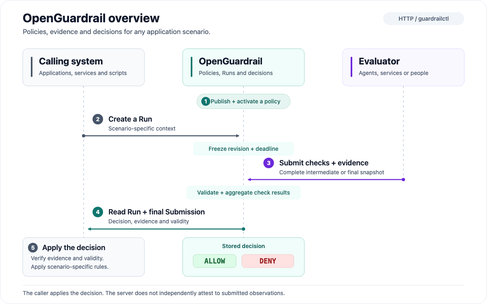

# Getting started

The console, CLI and management API use direct access. Only assessment submission requires a Run credential. See [Access](access.md).

After the first batch deploys, have your coding agent follow the Spec and inspect metrics, logs and alerts before the next batch proceeds. [Watch the 30-second run](media/first-batch-run.mp4)

## Run the first-batch check

With Make, Python 3.9+ and the Go version in `go.mod` installed, open the checkout containing `examples/agent-demo/first_batch.py` in your coding agent (such as Claude Code, Cursor, Codex, or Antigravity) and send this message.

> Use $open-guardrail-demo to check the first batch and tell me whether the next batch can proceed.

The agent starts a temporary service, checks metrics, logs and alerts against the Spec, and shows its findings and the recorded decision in chat. In the default synthetic data, payment for `order-42` was captured while its state is still `pending`. Expect `BLOCKED / DENY`. No OpenGuardrail console login is needed.

The agent links a local JSON file with the Run report and the observations behind its decision. You can reopen it after the temporary service, database and credentials are removed. To inspect the live console, ask for it when starting the trial.

## Evaluation flow

[](images/overview.svg)

Open the diagram for the full-size SVG. See [core concepts](concepts.md) for the
policy, assessment and decision model.

## Prerequisites

For a source checkout:

- The Go toolchain specified in `go.mod`.
- Make for `make build`.
- Python 3.9+ only if you run the local demo below.

Run commands from the checkout root. Building the server and CLI does not require
Node.js or Docker.

If you received a preview binary archive, first follow
[archive verification](releases.md#check-and-try-a-downloaded-archive).
Run commands from its extraction root. Use `./open-guardrail` and
`./guardrailctl` in place of the source build's `./bin/` paths; running the
binaries needs no Go, Node.js or Python.

## Optional file cleanup without a model

With Python 3.9+ available, run the following command from the source checkout
or archive root. A source checkout also needs Go:

```sh
python3 examples/cleanup-demo/demo.py
```

The script builds the commands from source or uses the binaries in an archive.
It starts a temporary direct-access local service and a controlled file cleanup tool. Source builds can download Go
dependencies on their first run. The demo needs Python 3.9+; release assembly
and the maintainer verification scripts separately require Python 3.12+.

Open the printed **Demo** URL first. No login is required for the cleanup task
or its Run details. Leave the default selection and click **Run cleanup task**:

1. The runner requests deletion of all four sample files, including protected
   orders and configuration. The service stores a `BLOCKED / DENY` Run.
2. The runner narrows its request to the two temporary files and submits a new
   assessment. The service stores a `PASS / ALLOW` Run.
3. The deletion tool rereads the Run and accepted evidence, verifies their
   identity and validity, and deletes only the approved temporary files.
4. Inspect both Runs in the page. Restore the files, change the selection or
   batch limit and rerun to compare the actual result.

Leave the terminal open while inspecting the records. Ctrl-C stops the service
and removes its temporary data and credentials. The original Recovery contract
self-check is available with `python3 examples/agent-demo/smoke.py`; it exits
and cleans up immediately. Its `--keep-running` option preserves the records for
browser inspection until Ctrl-C.
Use the walkthrough below when you want persistent data or your own policy.


## Connect to your own workflow

Once you've seen how a Run works, connect OpenGuardrail directly to your agent or CD pipeline:

- **MCP tools (Cursor, Claude Code, Cline):** Wrap any stdio MCP server with `guardrailctl mcp-proxy` so ordinary unmatched calls pass through and configured or destructive calls require argument-bound evidence. See the [MCP Proxy guide](../integrations/mcp-proxy/README.md).
- **GitHub Actions CD gate:** Use the composite Action and 3-check `release-gate.yaml` Spec to independently verify an unexpired `ALLOW` before production deployment. See the [GitHub Actions guide](../integrations/github-actions/README.md).

## Manual walkthrough: create and inspect your first Run

### 1. Start the service

From a source checkout:

```sh
make build
./bin/open-guardrail serve
```

Keep that terminal open. The listener defaults to `127.0.0.1:8080`, with SQLite
data in `./data/guardrail.db` relative to the startup directory.

Open <http://127.0.0.1:8080> to enter the console directly. No account setup is required.
For shared deployments, see [Docker](docker.md) and [Access](access.md).

### 2. Connect the CLI

Open a second terminal in the same checkout root:

```sh
guardrail_cli=./bin/guardrailctl
export OPEN_GUARDRAIL_URL=http://127.0.0.1:8080
umask 077
guardrail_demo_dir=$(mktemp -d)
"$guardrail_cli" status
```

For an extracted binary archive, set `guardrail_cli=./guardrailctl` instead.
The temporary private directory holds the Run Submission credential.

### 3. Publish the example policy

```sh
"$guardrail_cli" scene apply --key recovery --name Recovery \
  --spec ./examples/policies/recovery.yaml --publish
```

The policy requires a `readiness` check with `health` evidence. The command
publishes and activates the revision.

See [Scenes and Specs](scenes-and-specs.md) for policy editing and publication.

### 4. Create a Run

Create a synthetic change description, then create one evaluation:

```sh
cat > "$guardrail_demo_dir/change-set.json" <<'JSON'
{
  "application": "example-service",
  "environment": "local",
  "operation": "recovery"
}
JSON
guardrail_demo_operation="quickstart-$(date +%s)-$$"
"$guardrail_cli" run create \
  \
  --scene recovery \
  --change-set "$guardrail_demo_dir/change-set.json" \
  --operation-id "$guardrail_demo_operation-create" \
  --submission-credential-file "$guardrail_demo_dir/run-credential.json"
```

The command prints a Run object with `status: "OPEN"`. Copy its top-level `id`
into this variable, replacing the example value:

```sh
guardrail_demo_run_id=run_REPLACE_WITH_RETURNED_ID
```

The Run freezes the policy revision, caller-defined `changeSet` and deadline.
The submission credential is saved privately; the CLI does not print its token.

Complete the next step before the Run deadline. For an uncertain create result,
retain the same operation ID and inspect state before retrying. The initial
credential is returned only once; see [credential recovery](runs.md).

### 5. Submit a synthetic passing assessment

Submit a synthetic passing assessment; the timestamp is generated at execution time:

```sh
cat > "$guardrail_demo_dir/submission.json" <<JSON
{
  "baseSubmissionNo": 0,
  "finishRun": true,
  "verdict": "PASS",
  "summary": "Synthetic local recovery assessment",
  "checks": [
    {
      "checkId": "readiness",
      "verdict": "PASS",
      "summary": "Synthetic health observation is healthy",
      "evidence": [
        {
          "requirementId": "health",
          "observedAt": "$(date -u +%Y-%m-%dT%H:%M:%SZ)",
          "querySummary": "Read a synthetic local health observation",
          "resultSummary": "Example service is healthy; no real service was queried"
        }
      ]
    }
  ]
}
JSON
"$guardrail_cli" run submit \
  --submission-credential-file "$guardrail_demo_dir/run-credential.json" \
  --submission "$guardrail_demo_dir/submission.json" \
  --operation-id "$guardrail_demo_operation-submit" \
  "$guardrail_demo_run_id"
"$guardrail_cli" run get \
  \
  "$guardrail_demo_run_id"
```

The returned Run should have `status: "FINISHED"`, `result: "PASS"` and
`decision: "ALLOW"`, plus its final submission ID and decision expiry.

### 6. Inspect the record

In the browser, open **Runs**, select the returned Run ID and inspect its frozen
policy reference, evaluation context, submitted evidence and decision.

A real integration must verify the authoritative Run, decision validity and
observations it relies on. See [Runs and submissions](runs.md) and the
[integration recipes](../integrations/README.md).

## Troubleshooting

| Symptom | Next step |
| --- | --- |
| Python version error | Check `python3 --version` and use Python 3.9+ for the demo. The native binaries and manual walkthrough do not require Python. |
| Go is missing or the build fails | A source checkout needs the Go version in `go.mod` and access to its public dependencies. Run `make build` for compiler diagnostics, or use a native archive. |
| Server exits or does not become ready | The cleanup demo reports a safe error category and the command's exit code when available. Run `./bin/open-guardrail serve` from source or `./open-guardrail serve` from an archive for detailed startup diagnostics. Check the data directory, native binaries and port. |
| Demo address returns 403 | Open exactly the printed `http://127.0.0.1:<port>` address. The cleanup demo does not accept `localhost` or other hostnames. |
| Recovery self-check exits before you can open Runs | Run `python3 examples/agent-demo/smoke.py --keep-running` and keep that terminal open. The default Recovery self-check deliberately removes its temporary records; the cleanup demo already stays running. |

## Clean up or keep exploring

Ctrl-C stops the service. Restart from the same data directory to retain Scenes, Specs and Runs.
Keep Run Submission credentials private; remove temporary credential files when finished.
See [Runs](runs.md) for expiry, retries and rotation.
