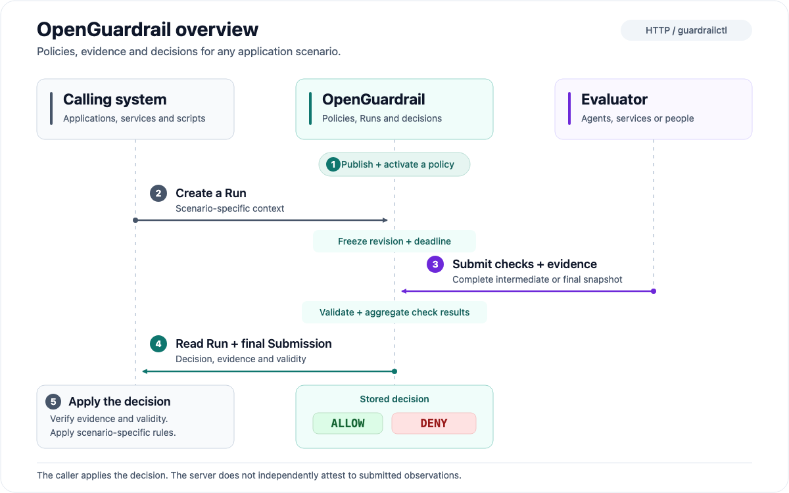

# Getting started

Run a guarded file cleanup task, or follow the walkthrough to publish a policy,
create a Run and inspect its evidence in the browser.
Neither option requires an AI model.

## Evaluation flow

[](images/overview.svg)

Open the diagram for the full-size SVG. See [core concepts](concepts.md) for the
policy, assessment and decision model.

## Prerequisites

For a source checkout:

- The Go toolchain specified in `go.mod`.
- Make for `make build`.
- Python 3.9+ only if you run the local demo below.

Run commands from the checkout root. Building the server and CLI does not require
Node.js or Docker.

If you received a preview binary archive, first follow
[archive verification](releases.md#check-and-try-a-downloaded-archive).
Run commands from its extraction root. Use `./open-guardrail` and
`./guardrailctl` in place of the source build's `./bin/` paths; running the
binaries needs no Go, Node.js or Python.

## Option 1: run a guarded cleanup task

With Python 3.9+ available, run the following command from the source checkout
or archive root. A source checkout also needs Go:

```sh
python3 examples/cleanup-demo/demo.py
```

Choose a console password for the temporary `demo` administrator at the hidden prompts.
The script builds the commands from source or uses the binaries in an archive.
It starts a temporary local service and a controlled file cleanup tool. Source builds can download Go
dependencies on their first run. The demo needs Python 3.9+; release assembly
and the maintainer verification scripts separately require Python 3.12+.

Open the printed **Demo** URL first. No login is required for the cleanup task
or its Run details. Leave the default selection and click **Run cleanup task**:

1. The runner requests deletion of all four sample files, including protected
   orders and configuration. The service stores a `BLOCKED / DENY` Run.
2. The runner narrows its request to the two temporary files and submits a new
   assessment. The service stores a `PASS / ALLOW` Run.
3. The deletion tool rereads the Run and accepted evidence, verifies their
   identity and validity, and deletes only the approved temporary files.
4. Inspect both Runs in the page. Restore the files, change the selection or
   batch limit and rerun to compare the actual result.

The runner is predefined code without a model. Its service calls and file
operations are real. The [demo guide](../examples/cleanup-demo/README.md)
explains the execution checks and limits. To inspect the same records in the
regular UI, open the printed **Console** URL, sign in as `demo` with the chosen
password, and select **Runs**.

Leave the terminal open while inspecting the records. Ctrl-C stops the service
and removes its temporary data and credentials. The original Recovery contract
self-check is available with `python3 examples/agent-demo/smoke.py`; it exits
and cleans up immediately. Its `--keep-running` option preserves the records for
browser inspection until Ctrl-C.
Use the walkthrough below when you want persistent data or your own policy.

For automation, `--password-stdin` reads a chosen password from standard input
when starting the cleanup demo. Do not put passwords in command-line
arguments or committed scripts. The source-only `make demo` target is equivalent
to the interactive demo command above.

## Option 2: create and inspect your first Run

### 1. Start the service

From a source checkout:

```sh
make build
./bin/open-guardrail serve
```

Keep that terminal open. The listener defaults to `127.0.0.1:8080`, with SQLite
data in `./data/guardrail.db` relative to the startup directory.

Open <http://127.0.0.1:8080> and create an administrator named `admin` with a
password you choose. Setup signs you into the browser automatically. There is no
default password.

Local setup without a bootstrap token requires a direct loopback connection.
For remote or container deployment, follow [Docker deployment](docker.md) and
[administrator setup](local-administrator.md).

### 2. Sign in to the CLI

Open a second terminal in the same checkout root:

```sh
guardrail_cli=./bin/guardrailctl
export OPEN_GUARDRAIL_URL=http://127.0.0.1:8080
umask 077
guardrail_demo_dir=$(mktemp -d)
export OPEN_GUARDRAIL_SESSION_FILE="$guardrail_demo_dir/session.json"
"$guardrail_cli" status
"$guardrail_cli" auth login --username admin
```

For an extracted binary archive, set `guardrail_cli=./guardrailctl` instead.
Enter your administrator password at the hidden prompt. Browser and CLI sessions
are separate. This example stores its CLI session and machine credentials in a
private temporary directory outside the source tree.

### 3. Publish the example policy

```sh
"$guardrail_cli" scene apply --key recovery --name Recovery \
  --spec ./examples/policies/recovery.yaml --publish
"$guardrail_cli" auth create-key --expires-in 1h \
  --result-file "$guardrail_demo_dir/project-key.json"
```

The policy requires a `readiness` check with `health` evidence. The command
publishes and activates the revision; the temporary Project key lasts one hour.

See [Scenes and Specs](scenes-and-specs.md) for policy editing and publication.

### 4. Create a Run

Create a synthetic change description, then create one evaluation:

```sh
cat > "$guardrail_demo_dir/change-set.json" <<'JSON'
{
  "application": "example-service",
  "environment": "local",
  "operation": "recovery"
}
JSON
guardrail_demo_operation="quickstart-$(date +%s)-$$"
"$guardrail_cli" run create \
  --key-file "$guardrail_demo_dir/project-key.json" \
  --scene recovery \
  --change-set "$guardrail_demo_dir/change-set.json" \
  --operation-id "$guardrail_demo_operation-create" \
  --submission-credential-file "$guardrail_demo_dir/run-credential.json"
```

The command prints a Run object with `status: "OPEN"`. Copy its top-level `id`
into this variable, replacing the example value:

```sh
guardrail_demo_run_id=run_REPLACE_WITH_RETURNED_ID
```

The Run freezes the policy revision, caller-defined `changeSet` and deadline.
The submission credential is saved privately; the CLI does not print its token.

Complete the next step before the Run deadline. For an uncertain create result,
retain the same operation ID and inspect state before retrying. The initial
credential is returned only once; see [credential recovery](runs.md).

### 5. Submit a synthetic passing assessment

Submit a synthetic passing assessment; the timestamp is generated at execution time:

```sh
cat > "$guardrail_demo_dir/submission.json" <<JSON
{
  "baseSubmissionNo": 0,
  "finishRun": true,
  "verdict": "PASS",
  "summary": "Synthetic local recovery assessment",
  "checks": [
    {
      "checkId": "readiness",
      "verdict": "PASS",
      "summary": "Synthetic health observation is healthy",
      "evidence": [
        {
          "requirementId": "health",
          "observedAt": "$(date -u +%Y-%m-%dT%H:%M:%SZ)",
          "querySummary": "Read a synthetic local health observation",
          "resultSummary": "Example service is healthy; no real service was queried"
        }
      ]
    }
  ]
}
JSON
"$guardrail_cli" run submit \
  --submission-credential-file "$guardrail_demo_dir/run-credential.json" \
  --submission "$guardrail_demo_dir/submission.json" \
  --operation-id "$guardrail_demo_operation-submit" \
  "$guardrail_demo_run_id"
"$guardrail_cli" run get \
  --key-file "$guardrail_demo_dir/project-key.json" \
  "$guardrail_demo_run_id"
```

The returned Run should have `status: "FINISHED"`, `result: "PASS"` and
`decision: "ALLOW"`, plus its final submission ID and decision expiry.

### 6. Inspect the record

In the browser, open **Runs**, select the returned Run ID and inspect its frozen
policy reference, evaluation context, submitted evidence and decision.

A real integration must verify the authoritative Run, decision validity and
observations it relies on. See [Runs and submissions](runs.md) and the
[integration recipes](../integrations/README.md).

## Troubleshooting

| Symptom | Next step |
| --- | --- |
| Python version error | Check `python3 --version` and use Python 3.9+ for the demo. The native binaries and manual walkthrough do not require Python. |
| Go is missing or the build fails | A source checkout needs the Go version in `go.mod` and access to its public dependencies. Run `make build` for compiler diagnostics, or use a native archive. |
| Server exits or does not become ready | The cleanup demo reports a safe error category and the command's exit code when available. Run `./bin/open-guardrail serve` from source or `./open-guardrail serve` from an archive for detailed startup diagnostics. Check the data directory, native binaries and port. |
| Demo address returns 403 | Open exactly the printed `http://127.0.0.1:<port>` address. The cleanup demo does not accept `localhost` or other hostnames. |
| Recovery self-check exits before you can open Runs | Run `python3 examples/agent-demo/smoke.py --keep-running` and keep that terminal open. The default Recovery self-check deliberately removes its temporary records; the cleanup demo already stays running. |
| Browser login fails | Use username `demo` and the password you chose for this invocation. The walkthrough's `admin` account and an existing service are separate. |
| Hidden password prompt needs a terminal | Run interactively, or pass `--password-stdin` for automation. The Recovery self-check additionally needs `--keep-running` when you want to inspect its temporary records. |

The demo never prints its password or captured credential-bearing command output.
When reporting a problem, include the step, exit code, version and platform.
Keep passwords, session files and machine credential files private.

## Clean up or keep exploring

The service data persists in `./data`. Stop the server with Ctrl-C and restart
from the same directory to keep your administrator, policy and Run.
Use `--data-dir /path/to/persistent/data` when you want an explicit storage location.

First revoke only the Project key created for this walkthrough. While the
administrator CLI session is still active, inspect the secret-free metadata:

```sh
"$guardrail_cli" auth list-keys --page-size 20
```

Identify the walkthrough's key by its issuance time, role and scopes. Its private
credential file also records the same non-secret `keyId`; compare only that field
locally if needed, without displaying or sharing the token. Follow `nextAfter`
with `--after CURSOR` if the key is on another page. Do not revoke a key used by
another integration.

Replace the example ID with the selected key's `id`, then revoke it:

```sh
guardrail_demo_key_id=key_REPLACE_WITH_DEMO_KEY_ID
"$guardrail_cli" auth revoke-key --key-id "$guardrail_demo_key_id"
```

After revocation succeeds, remove the temporary CLI session and files in the
second terminal while its variables are still set. If revocation fails, retain
the session and credential file until you have resolved the error.

```sh
"$guardrail_cli" auth logout
rm -f "$guardrail_demo_dir/session.json" \
  "$guardrail_demo_dir/project-key.json" \
  "$guardrail_demo_dir/run-credential.json" \
  "$guardrail_demo_dir/change-set.json" \
  "$guardrail_demo_dir/submission.json"
rmdir "$guardrail_demo_dir"
unset OPEN_GUARDRAIL_SESSION_FILE
```

Removing a machine key file does not revoke that key. Revocation and secret
rotation are implemented; revocation immediately prevents subsequent key
authentication without canceling already-authenticated requests. See
[Project machine keys](local-administrator.md#project-machine-keys) for lifetime,
rotation and recovery rules. Use this walkthrough with a local evaluation service.

Next, try the [agent-driven demo](../examples/agent-demo/README.md), configure
[PostgreSQL or remote access](configuration.md), or read the
[contribution guide](../CONTRIBUTING.md).
