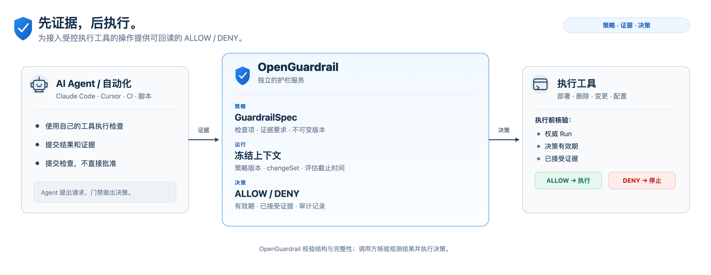
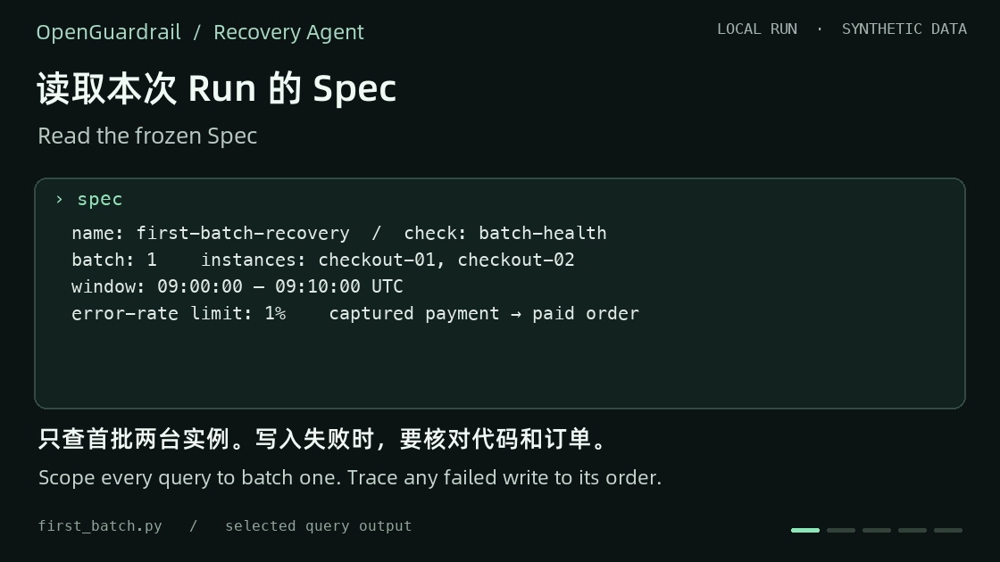
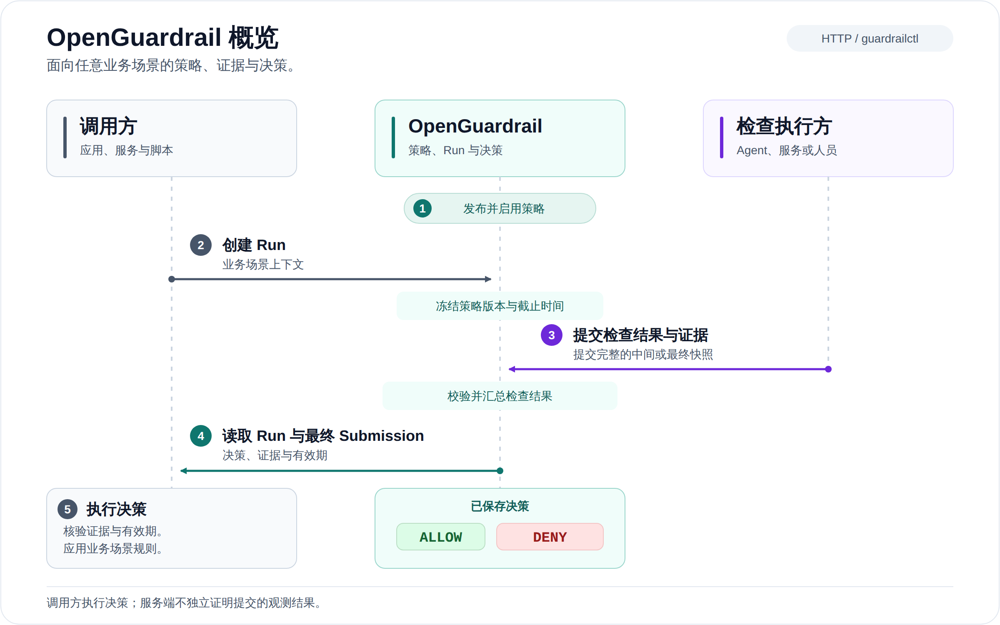
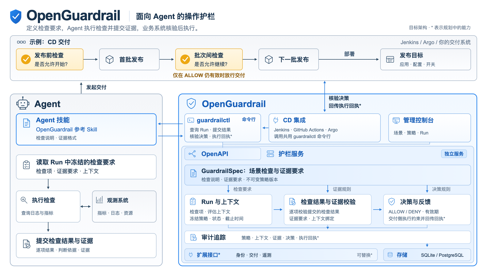

<div align="center">


# OpenGuardrail

[English](../../README.md) | 简体中文

### 面向 AI Agent 的循证操作护栏

[](../../go.mod)
[](../../LICENSE)

[看看实际效果](#看看实际效果) · [快速开始](#快速开始) · [工作流程](#工作流程) · [参考集成](#参考集成)

</div>

## 概述

OpenGuardrail 是专为操作真实系统的 AI Agent 打造的安全准入与审计服务。

团队预先定义高风险操作前必须完成的前置检查；Agent 按策略执行检查并提交结构化证据后，OpenGuardrail 会校验证据完整性、落库审计记录并返回 `ALLOW` 或 `DENY`。最终由下游执行工具在真正动手前核验裁决结果及其有效期。

每次评估都会将策略版本、检查结果、原始证据和最终裁决强绑定，既能作为执行前的准入凭据，也便于事后合规审计。Agent 与业务工具可通过 HTTP API 或 `guardrailctl` CLI 接入。

**当前状态：开发预览版。** API 版本为 `v1alpha1`，具体能力与边界见
[当前能力与限制](#当前能力与限制)。

[](../images/readme-hero.zh-CN.svg)

*Agent 提出请求，门禁做出决策。OpenGuardrail 校验证据的结构与完整性；
调用方核验观测结果并执行决策。*

[源代码](https://github.com/alibaba/open-guardrail) · [问题反馈](https://github.com/alibaba/open-guardrail/issues) ·
[入门指南](getting-started.zh-CN.md) · [文档](#文档) · [API 与 CLI](api.zh-CN.md) ·
[部署](configuration.zh-CN.md) · [参与贡献](../../CONTRIBUTING.md) ·
[Apache-2.0](../../LICENSE)

## 看看实际效果

**首批发布完成后，下一批还能继续吗？**

生产发布通常分批进行。第一批机器上线后，值班同学需要看监控、查错误日志、核对告警，确认没问题再放行第二批——在阿里巴巴内部，我们已经将 OpenGuardrail 落地在这一步。

下面用本地模拟数据演示一次 `checkout` 结算服务的发布复核：新版本改动了“扣款后更新订单状态”的逻辑，应用负责人把放行条件写进了 Spec——除了常规监控和告警，Agent 还必须排查首批实例的错误日志；一旦发现写库失败，就顺着报错核对本次代码改动，并按日志里的订单号反查订单状态，确认是否存在“已扣款但订单未标记为已支付”的资金风险。

| 证据来源 | Agent 查到了什么 |
| --- | --- |
| 监控与告警 | 核对首批实例的错误率与活动告警：错误率处于阈值内，无活动告警。 |
| 错误日志 | 同一批实例在发布后出现了新的写库异常。 |
| 代码与数据 | 本次代码恰好改到了报错的写入路径；只读反查确认，订单 `order-42` 已扣款但状态仍停留在 `pending`。 |

Agent 汇总观测窗口、首批实例范围、脱敏摘要及可追溯引用并提交。由于写库异常已波及业务订单，本次检查结论为 `BLOCKED`，OpenGuardrail 记录 `DENY`（本示例仅在本地模拟决策，实际暂停或放行由发布系统执行；若必查日志不可用且现有证据不足以判断，Agent 会上报 `UNKNOWN` 并指明缺失项，系统同样拦截为 `DENY`）。

[](../media/first-batch-run.mp4)

[播放 30 秒示例回放（MP4，可暂停）](../media/first-batch-run.mp4)

## 快速开始

在你的 AI 编程助手（如 Claude Code、Cursor、Codex、Antigravity 等）中打开包含 `examples/agent-demo/first_batch.py` 的仓库目录（需提前备好 Make、Python 3.9+ 及 `go.mod` 指定的 Go 版本），直接发送下面这句话：

> 用 $open-guardrail-demo 跑一遍首批检查，告诉我下一批能不能发。

Agent 会自动拉起本地临时服务，按 Spec 依次排查首批实例的监控、日志与告警，并在对话里给出排查过程和最终裁决。默认模拟数据中，订单 `order-42` 已扣款但状态仍停留在 `pending`，因此预期结果为 `BLOCKED / DENY`（全程无需登录控制台；若宿主未自动识别 `.agents/skills/`，可让它按 `.agents/skills/open-guardrail-demo/SKILL.md` 执行）。

检查完成后，Agent 会生成一个本地 JSON 报告链接，里面保留了服务端诊断记录与采信的观测证据；哪怕随后关掉临时服务、清理了临时库和凭据，这份报告依然可以随时打开回看。如果想在 Web 控制台查看详情，在启动时告诉它开启即可。

在同一个对话里，复制任意一句再跑一轮：

```text
换一组正常数据再跑一次
```

```text
如果日志查不到呢？
```

正常数据的预期结果是 `PASS / ALLOW`。如果必查日志无法读取，Agent 会说明缺少的证据，预期结果是 `UNKNOWN / DENY`。

首次获取源码可运行 `git clone https://github.com/alibaba/open-guardrail.git`。

[如何在控制台查看 Run 报告](audit-and-reports.zh-CN.md#run-报告) · [查看首批检查 Spec](../../examples/agent-demo/first-batch.yaml) · [试跑正常或日志缺失的情况](../../examples/agent-demo/README.md#try-it-with-your-coding-agent)

**可选：不用模型体验文件清理。** 在仓库根目录运行 `python3 examples/cleanup-demo/demo.py`，直接打开输出的 Demo 地址（无需登录，也无需手动设置密码）。点击「运行清理任务」，看看包含订单文件的请求如何被拦截，以及缩小范围后哪两个临时文件被删除。[文件清理指南](../../examples/cleanup-demo/README.md)

**保护你自己的 Agent 或流水线。** 建议优先通过 `PreToolUse` 钩子或宿主适配器接入（参考 [Agent 插件](../../integrations/agent-plugins/README.md)），在工具实际执行前自动创建 Run、附带观测证据并拦截高风险调用；也可以在 [CI/CD 交付流水线](../../integrations/README.md) 的关键卡点接入。

## 为什么需要 OpenGuardrail？

一旦赋予 AI Agent 操作真实系统的权限，安全检查就不能只停留在口头约束上。光在 System Prompt 里叮嘱“操作前先检查”并不可靠，下游执行工具需要可核验的放行依据，事后安全审计也需要完整追溯当时依据的策略版本、检查结论与原始证据。

如果这些上下文散落在 Agent 对话记录和工具日志里，每个业务工具都得各自去提取、关联、兜底。OpenGuardrail 将其收拢为标准化的评估与存证记录，方便执行端在动手前统一核验，也便于事后复盘。

### 适用边界

**适用场景：** 当 Agent 或自动化任务需要执行删除数据、发布应用、修改配置等高风险操作，且团队要求对每次放行做到“执行前可核验、事后可审计”时。

**接入要求：** 前置检查由 Agent 或外部集成程序执行并提交证据；真正执行危险动作的下游工具，需在动手前读取权威 Run 记录，核验裁决结果、有效期、依赖证据及当前目标状态。

**能力边界：** OpenGuardrail 负责按策略校验提交内容并记录 `ALLOW` 或 `DENY`，但**不独立验证观测事实的真实性**；拿到 `ALLOW` 也不等同于自动授予业务权限。绕过受控工具的直接操作不在防护范围内，OpenGuardrail 本身也不提供进程或网络沙箱隔离。

## 工作流程

**Scene（场景）**用于归类同一类高风险操作的策略。同一场景共用一套策略、证据和决策模型，单次评估流转分为五步：

[](../images/overview.zh-CN.svg)

1. **发布策略。** 在 GuardrailSpec 中定义检查项和证据要求，发布不可变的策略版本，
   再将其设为场景的生效版本。
2. **创建评估记录。** 创建 Run，记录操作上下文，并冻结选定的策略版本和评估截止时间。
3. **执行检查并提交。** Agent 读取 Run 的策略要求，使用工具完成检查，提交完整的结果和证据。
   最终提交前可以先提交中间快照。
4. **读取决策。** 查询权威 Run 记录，获取已保存的决策及其有效期，
   再读取它引用的 Submission，检查其中的证据。
5. **核验后执行。** 执行工具核验权威决策、有效期和证据，并结合业务规则判断是否执行操作。

Run 完成后，检查结果按以下规则汇总：

| 评估结果 | 含义 | 决策 |
| --- | --- | --- |
| `PASS` | 所有检查均通过 | `ALLOW` |
| `BLOCKED` | 至少一项检查确认不满足要求 | `DENY` |
| `UNKNOWN` | 没有检查确认不满足要求，但至少一项无法判断 | `DENY` |

未完成的 Run 可能超时，已完成的决策也有独立的有效期。
集成方必须检查权威 Run 记录、评估截止时间和决策有效期。
详见 [Run 与提交](runs.zh-CN.md)。

## 接入与部署

[原生包安装](native-install.zh-CN.md) · [pi / DeepSeek Harness 插件](../plugin-trial.zh-CN.md)

### 启动持久运行的服务

如果希望持续运行服务，并在浏览器中查看自己的 Run，请在源码仓库根目录使用 Go 和 Make：

```sh
make build
./bin/open-guardrail serve
```

打开 <http://127.0.0.1:8080>，创建首个管理员账号。系统没有默认密码。
SQLite 将数据保存在 `./data`，无需另行部署数据库服务。

### 接下来做什么

| 目标 | 指南 |
| --- | --- |
| 理解策略如何影响决策 | [入门指南](getting-started.zh-CN.md)：发布策略、提交评估并查看证据 |
| 让 Agent 完成检查 | [Agent Demo](../../examples/agent-demo/README.md)：让 Agent 评估示例观测数据并提交检查结果 |
| 为自己的工具接入操作护栏 | [集成指南](integrations.zh-CN.md)和 [API 与 CLI](api.zh-CN.md)：定义检查项、连接观测来源，并在执行工具中核验决策 |

## 目标架构

下图以 CD 交付为例，展示共用的护栏模型：Agent 按场景要求完成检查并提交证据，
OpenGuardrail 校验提交内容并记录决策，执行工具在操作前核验决策和证据。
蓝色组件属于 OpenGuardrail，灰色组件表示 Agent 和外部系统。

[](../images/target-architecture.zh-CN.svg)

*点击图片可查看完整尺寸的 SVG。Execution Claims 与执行回执、可替换的 provider，
以及部分 CD 集成仍在规划中。服务端校验证据的结构与完整性，由调用方核验观测结果。
当前可用能力见[当前能力与限制](#当前能力与限制)和[参考集成](#参考集成)。*

## 当前能力与限制

预览版已包含：

- 独立的 Go 服务、通过 HTTP 调用服务的 CLI，以及内嵌管理界面。
- 本地管理员初始化、浏览器与 CLI 会话，以及具有作用域和有效期限制的机器凭据。
  支持列出凭据元数据、轮换密钥和撤销凭据。
- 场景、可编辑的策略草稿，以及不可变的策略版本。
- 冻结策略与评估上下文的 Run、中间提交和最终提交、结构化证据、超时处理和持久化决策。
- SQLite 与 PostgreSQL 存储适配器；每个数据库只运行一个服务实例。
- 面向 Linux、macOS 的 amd64 和 arm64 原生归档，以及部署在 HTTPS 代理后的可选 Docker 方案。

当前边界：

- 检查由服务外部的 Agent 或集成程序执行。服务端不会独立验证提交的观测结果，
  也尚未实现外部检查执行方的注册与可信性证明。
- 决策的落实和实际操作控制由调用方负责。Execution Claims 和 ActionResults 仍在规划中。
- 暂不支持多实例运行，也未提供可替换的身份与 provider API。
- 预览阶段的 Alpha API 和存储契约可能调整。

更多信息见[路线图](development-roadmap.zh-CN.md)、[运行时架构](architecture.zh-CN.md)
和[安全策略](../../SECURITY.md)。

## 参考集成

可以通过带版本的 [HTTP/OpenAPI 契约](../../api/openapi/openapi.yaml)
或[共用 CLI](cli.zh-CN.md)，接入应用、服务、脚本或 Agent。
示例覆盖本地文件操作与交付流程。

| 集成 | 当前状态 |
| --- | --- |
| [真实文件清理 Demo](../../examples/cleanup-demo/README.md) | 在临时目录中创建真实 Run 并执行受控删除；使用预设程序，未接入模型 |
| [本地 Recovery Agent Demo](../../examples/agent-demo/README.md) | 使用合成观测数据，支持 Agent 评估与确定性自检 |
| [Jenkins](../../integrations/jenkins/README.md) | 使用合成数据的流水线 Demo，由外部 Agent 执行检查、交付侧核验证据 |
| [Argo Rollouts](../../integrations/argo/README.md) | 使用合成数据的 Analysis Job Demo |
| [GitHub Actions](../../integrations/github-actions/README.md) | 面向接入方的工作流仍在规划中 |
| [Argo CD](../../integrations/argo/README.md) | Sync hooks 仍在规划中 |

这些示例用于展示集成契约，适用范围和前置条件见[集成指南](integrations.zh-CN.md)。

## 文档

可从[文档索引](../README.md)选择阅读路径，或先阅读[核心概念](concepts.zh-CN.md)，
了解 Scene、Policy、Run 和 Submission 模型。

| 我想…… | 从这里开始 |
| --- | --- |
| 运行本地示例并查看决策 | [入门指南](getting-started.zh-CN.md) |
| 配置存储或远程服务 | [配置与存储](configuration.zh-CN.md)、[Docker 部署](docker.zh-CN.md) |
| 管理管理员账号与凭据 | [管理员指南](local-administrator.zh-CN.md) |
| 编写并发布策略 | [GuardrailSpec YAML 字段手册](guardrailspec-reference.zh-CN.md)、[场景与 Spec](scenes-and-specs.zh-CN.md) |
| 追溯一次决策 | [审计查询与 Run 排障报告](audit-and-reports.zh-CN.md) |
| 创建 Run 并提交证据 | [Run 与提交](runs.zh-CN.md) |
| 调用 API 或使用 CLI 自动化 | [API 概览](api.zh-CN.md)、[CLI 指南](cli.zh-CN.md) |
| 理解实现方式或扩展计划 | [架构](architecture.zh-CN.md)、[扩展边界](../extensions.md) |
| 构建、参与贡献或准备发布版本 | [开发指南](../development.md)、[发布说明](../release-notes.md)、[发布校验](../releases.md) |

## 参与贡献与支持

欢迎提交缺陷报告、文档改进、集成反馈，以及范围明确的代码改动。
环境准备、问题反馈要求和 Pull Request 流程见 [CONTRIBUTING.md](../../CONTRIBUTING.md)。

问题咨询和可复现的缺陷报告请提交至 [GitHub Issues](https://github.com/alibaba/open-guardrail/issues)，
附上版本号和使用合成数据的最小复现示例。安全漏洞请按照 [SECURITY.md](../../SECURITY.md)
私下报告。社区参与遵循[行为准则](../../CODE_OF_CONDUCT.md)。

## 许可证

OpenGuardrail 采用 [Apache License 2.0](../../LICENSE)。第三方组件保留各自的许可条款，
详见[声明清单](../../third_party/README.md)和[依赖许可审查](../dependency-licenses.md)。
