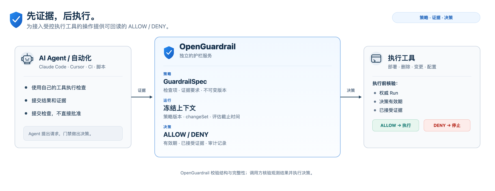
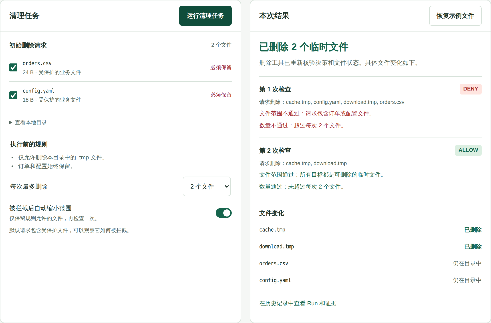
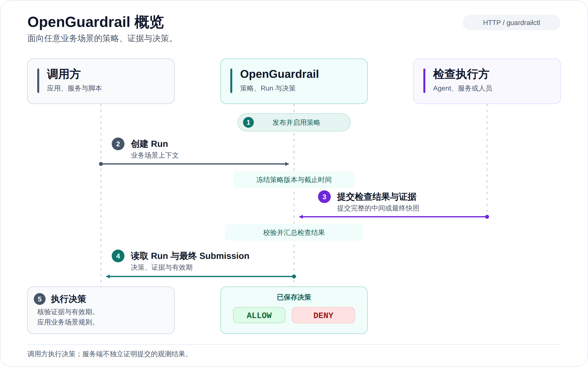
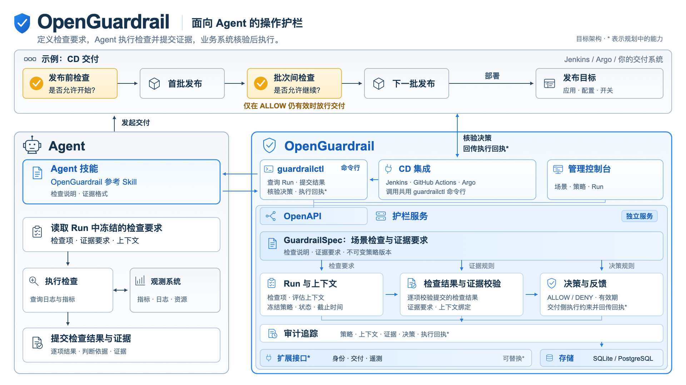

# OpenGuardrail

[English](../../README.md) | 简体中文

**为 AI Agent 提供基于证据的操作护栏。**

OpenGuardrail 是一个独立的护栏服务，面向需要操作真实系统的 AI Agent。

开发者定义执行操作前必须完成的检查。Agent 按策略执行检查，提交结果和证据。
OpenGuardrail 校验提交内容，保存评估记录，返回 `ALLOW` 或 `DENY`。
执行工具在实际操作前核验决策及其有效性。

每次评估都关联策略版本、检查结果、证据和决策，供执行前核验与后续审计使用。
Agent 和工具可以通过 HTTP API 或 `guardrailctl` CLI 接入。

**当前状态：开发预览版。** API 版本为 `v1alpha1`，具体能力与边界见
[当前能力与限制](#当前能力与限制)。

[](../../go.mod)
[](../../LICENSE)

[](../images/readme-hero.zh-CN.svg)

*Agent 提出请求，门禁做出决策。OpenGuardrail 校验证据的结构与完整性；
调用方核验观测结果并执行决策。*

[源代码](https://github.com/alibaba/open-guardrail) · [问题反馈](https://github.com/alibaba/open-guardrail/issues) ·
[入门指南](../getting-started.md) · [文档](../README.md) · [API 与 CLI](../api.md) ·
[部署](../configuration.md) · [参与贡献](../../CONTRIBUTING.md) ·
[Apache-2.0](../../LICENSE)

## 看看实际效果

预设的 Python 执行程序请求删除四个文件：两个临时文件，以及 `orders.csv` 和
`config.yaml`。由于请求包含受保护文件并超过批量上限，第一次检查被拦截。
执行程序随后缩小请求范围，第二次 Run 通过，执行工具只删除两个临时文件。

[](../../examples/cleanup-demo/README.md)

*预设执行程序、真实服务与文件；此 Demo 不使用 AI 模型。运行 `python3 examples/cleanup-demo/demo.py` 即可体验。*

## 为什么需要 OpenGuardrail？

Agent 获得真实系统的操作权限后，检查要求就需要落实到执行环节。
提示词可以要求 Agent 先检查，但执行工具仍需要可核验的放行依据；
事后审计也需要明确记录当时采用的策略、检查结果和证据。

如果这些信息只留在 Agent 的对话和工具日志中，执行方就需要自行提取、关联并判断。
OpenGuardrail 将它们组织成统一的评估记录，供工具在操作前核验，也便于事后追溯。

### 适用边界

**适用场景：** Agent 或自动化程序会触发删除数据、发布应用、修改配置等有实际影响的操作，
团队需要留存每次决策依据的策略、检查结果和证据，以便执行前核验和事后追溯。

**接入条件：** Agent 或集成程序执行检查并提交结果和证据。真正执行操作的工具在操作前
读取权威 Run，核验决策有效期、所依赖的证据，并在需要时核对当前目标状态。

**能力边界：** OpenGuardrail 校验提交是否符合策略并记录 `ALLOW` 或 `DENY`，但不独立
证明观测结果真实。记录了 `ALLOW` 不等于授予业务操作权限；绕过受控工具的操作不受这套
核验约束，OpenGuardrail 也不提供进程或网络隔离。

## 工作流程

**Scene（场景）**用于组织某类操作的策略。不同场景共用策略、证据和决策模型。
一次评估包含五个步骤：

[](../images/overview.zh-CN.svg)

1. **发布策略。** 在 GuardrailSpec 中定义检查项和证据要求，发布不可变的策略版本，
   再将其设为场景的生效版本。
2. **创建评估记录。** 创建 Run，记录操作上下文，并冻结选定的策略版本和评估截止时间。
3. **执行检查并提交。** Agent 读取 Run 的策略要求，使用工具完成检查，提交完整的结果和证据。
   最终提交前可以先提交中间快照。
4. **读取决策。** 查询权威 Run 记录，获取已保存的决策及其有效期，
   再读取它引用的 Submission，检查其中的证据。
5. **核验后执行。** 执行工具核验权威决策、有效期和证据，并结合业务规则判断是否执行操作。

Run 完成后，检查结果按以下规则汇总：

| 评估结果 | 含义 | 决策 |
| --- | --- | --- |
| `PASS` | 所有检查均通过 | `ALLOW` |
| `BLOCKED` | 至少一项检查确认不满足要求 | `DENY` |
| `UNKNOWN` | 没有检查确认不满足要求，但至少一项无法判断 | `DENY` |

未完成的 Run 可能超时，已完成的决策也有独立的有效期。
集成方必须检查权威 Run 记录、评估截止时间和决策有效期。
详见 [Run 与提交](../runs.md)。

## 快速开始

在本地运行同一个流程，观察受护栏约束的工具如何操作临时目录中的真实文件。
这次体验不需要模型账号、Jenkins、Docker 或独立数据库。

### 运行一个受护栏约束的任务

已发布的原生预览包见 [GitHub Releases](https://github.com/alibaba/open-guardrail/releases)。
下载当前平台的原生归档和 `SHA256SUMS`；插件用户再下载完整的 `-install.tar.gz` 插件安装包。
先按[归档验证说明](../releases.md)核验、解压，再用 Python 3.9+ 运行相同的清理 Demo；
原生包路径无需安装 Go。需要模型参与的 pi/DeepSeek Harness 体验时，
请使用独立的[插件安装指南](../plugin-trial.zh-CN.md)。下面的命令采用源码构建路径。

请先安装 Git、`go.mod` 中指定版本的 Go，以及 Python 3.9+：

```sh
git clone https://github.com/alibaba/open-guardrail.git
cd open-guardrail
python3 examples/cleanup-demo/demo.py
```

按照终端中的隐藏输入提示设置控制台密码。脚本会从源码构建两个命令行程序，
然后打印 **Demo** 和 **Console** 两个地址。
先打开 Demo 地址，无需登录。

点击**运行清理任务**。初始请求包含临时文件、订单和配置。
预设程序提交观测到的文件状态，得到真实的 `DENY`；随后缩小请求范围，
创建另一个 Run，得到 `ALLOW`。受控工具核验该 Run 及其证据后，仅删除临时文件，
订单和配置仍保留在磁盘上。

修改文件选择、关闭自动缩小范围，或降低每次删除数量上限，再次运行以比较结果。
展开 Run 可以查看其冻结的策略和已接受的证据。
执行程序未接入模型，服务调用和文件操作均为真实执行。
流程和限制详见 [Demo 指南](../../examples/cleanup-demo/README.md)。

请保持启动终端运行。按 Ctrl-C 会停止两个服务，并清理临时数据和凭据。
独立的 Console 使用用户名 `demo`，密码为启动时设置的密码；其中的 **Runs** 页面
包含相同的 Run ID。原有的四种 Recovery 契约自检场景仍可通过以下命令运行：
`python3 examples/agent-demo/smoke.py`。

### 启动持久运行的服务

如果希望持续运行服务，并在浏览器中查看自己的 Run，请在源码仓库根目录使用 Go 和 Make：

```sh
make build
./bin/open-guardrail serve
```

打开 <http://127.0.0.1:8080>，创建首个管理员账号。系统没有默认密码。
SQLite 将数据保存在 `./data`，无需另行部署数据库服务。

### 接下来做什么

| 目标 | 指南 |
| --- | --- |
| 理解策略如何影响决策 | [入门指南](../getting-started.md)：发布策略、提交评估并查看证据 |
| 让 Agent 完成检查 | [Agent Demo](../../examples/agent-demo/README.md)：让 Agent 评估示例观测数据并提交检查结果 |
| 为自己的工具接入操作护栏 | [集成指南](../../integrations/README.md)和 [API 与 CLI](../api.md)：定义检查项、连接观测来源，并在执行工具中核验决策 |

## 目标架构

下图以 CD 交付为例，展示共用的护栏模型：Agent 按场景要求完成检查并提交证据，
OpenGuardrail 校验提交内容并记录决策，执行工具在操作前核验决策和证据。
蓝色组件属于 OpenGuardrail，灰色组件表示 Agent 和外部系统。

[](../images/target-architecture.zh-CN.svg)

*点击图片可查看完整尺寸的 SVG。Execution Claims 与执行回执、可替换的 provider，
以及部分 CD 集成仍在规划中。服务端校验证据的结构与完整性，由调用方核验观测结果。
当前可用能力见[当前能力与限制](#当前能力与限制)和[参考集成](#参考集成)。*

## 当前能力与限制

预览版已包含：

- 独立的 Go 服务、通过 HTTP 调用服务的 CLI，以及内嵌管理界面。
- 本地管理员初始化、浏览器与 CLI 会话，以及具有作用域和有效期限制的机器凭据。
  支持列出凭据元数据、轮换密钥和撤销凭据。
- 场景、可编辑的策略草稿，以及不可变的策略版本。
- 冻结策略与评估上下文的 Run、中间提交和最终提交、结构化证据、超时处理和持久化决策。
- SQLite 与 PostgreSQL 存储适配器；每个数据库只运行一个服务实例。
- 面向 Linux、macOS 的 amd64 和 arm64 原生归档，以及部署在 HTTPS 代理后的可选 Docker 方案。

当前边界：

- 检查由服务外部的 Agent 或集成程序执行。服务端不会独立验证提交的观测结果，
  也尚未实现外部检查执行方的注册与可信性证明。
- 决策的落实和实际操作控制由调用方负责。Execution Claims 和 ActionResults 仍在规划中。
- 暂不支持多实例运行，也未提供可替换的身份与 provider API。
- 预览阶段的 Alpha API 和存储契约可能调整。

更多信息见[路线图](../development-roadmap.md)、[运行时架构](../architecture.md)
和[安全策略](../../SECURITY.md)。

## 参考集成

可以通过带版本的 [HTTP/OpenAPI 契约](../../api/openapi/openapi.yaml)
或[共用 CLI](../../cmd/guardrailctl/README.md)，接入应用、服务、脚本或 Agent。
示例覆盖本地文件操作与交付流程。

| 集成 | 当前状态 |
| --- | --- |
| [真实文件清理 Demo](../../examples/cleanup-demo/README.md) | 在临时目录中创建真实 Run 并执行受控删除；使用预设程序，未接入模型 |
| [本地 Recovery Agent Demo](../../examples/agent-demo/README.md) | 使用合成观测数据，支持 Agent 评估与确定性自检 |
| [Jenkins](../../integrations/jenkins/README.md) | 使用合成数据的流水线 Demo，由外部 Agent 执行检查、交付侧核验证据 |
| [Argo Rollouts](../../integrations/argo/README.md) | 使用合成数据的 Analysis Job Demo |
| [GitHub Actions](../../integrations/github-actions/README.md) | 面向接入方的工作流仍在规划中 |
| [Argo CD](../../integrations/argo/README.md) | Sync hooks 仍在规划中 |

这些示例用于展示集成契约，适用范围和前置条件见[集成指南](../../integrations/README.md)。

## 文档

可从[文档索引](../README.md)选择阅读路径，或先阅读[核心概念](../concepts.md)，
了解 Scene、Policy、Run 和 Submission 模型。以下详细文档目前以英文为主。

| 我想…… | 从这里开始 |
| --- | --- |
| 运行本地示例并查看决策 | [入门指南](../getting-started.md) |
| 配置存储或远程服务 | [配置与存储](../configuration.md)、[Docker 部署](../docker.md) |
| 管理管理员账号与凭据 | [管理员指南](../local-administrator.md) |
| 编写并发布策略 | [GuardrailSpec YAML 字段手册](guardrailspec-reference.zh-CN.md)、[场景与 Spec](../scenes-and-specs.md) |
| 创建 Run 并提交证据 | [Run 与提交](../runs.md) |
| 调用 API 或使用 CLI 自动化 | [API 概览](../api.md)、[CLI 指南](../../cmd/guardrailctl/README.md) |
| 理解实现方式或扩展计划 | [架构](../architecture.md)、[扩展边界](../extensions.md) |
| 构建、参与贡献或准备发布版本 | [开发指南](../development.md)、[发布说明](../release-notes.md)、[发布校验](../releases.md) |

## 参与贡献与支持

欢迎提交缺陷报告、文档改进、集成反馈，以及范围明确的代码改动。
环境准备、问题反馈要求和 Pull Request 流程见 [CONTRIBUTING.md](../../CONTRIBUTING.md)。

问题咨询和可复现的缺陷报告请提交至 [GitHub Issues](https://github.com/alibaba/open-guardrail/issues)，
附上版本号和使用合成数据的最小复现示例。安全漏洞请按照 [SECURITY.md](../../SECURITY.md)
私下报告。社区参与遵循[行为准则](../../CODE_OF_CONDUCT.md)。

## 许可证

OpenGuardrail 采用 [Apache License 2.0](../../LICENSE)。第三方组件保留各自的许可条款，
详见[声明清单](../../third_party/README.md)和[依赖许可审查](../dependency-licenses.md)。

- [审计查询与 Run 排障报告](audit-and-reports.zh-CN.md)
