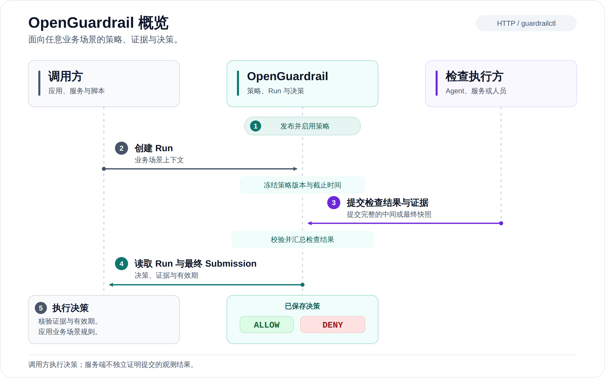

# 快速开始

运行一次受护栏约束的文件清理任务，或按下面的步骤发布策略、创建 Run，并在浏览器检查证据。这两种方式都不需要 AI 模型。

## 评估流程

[](../images/overview.zh-CN.svg)

点击流程图可以查看完整 SVG。策略、评估和决策模型见[核心概念](../concepts.md)。

## 前置条件

从源码运行需要：

- `go.mod` 指定的 Go 工具链。
- 执行 `make build` 所需的 Make。
- 只有运行下述本地 Demo 时，才需要 Python 3.9+。

在源码根目录运行命令。构建服务和 CLI 不需要 Node.js 或 Docker。

如果使用预览版二进制归档，先完成[归档校验](../releases.md#check-and-try-a-downloaded-archive)，再从解压根目录执行命令。用 `./open-guardrail` 和 `./guardrailctl` 替换源码构建的 `./bin/` 路径；运行二进制不需要 Go、Node.js 或 Python。

## 方式一：运行受护栏约束的清理任务

准备好 Python 3.9+ 后，在源码或归档根目录运行下列命令。从源码运行还需要 Go：

```sh
python3 examples/cleanup-demo/demo.py
```

在隐藏提示中，为临时管理员 `demo` 设置控制台密码。脚本会从源码构建命令，或使用归档中的二进制，然后启动临时本地服务和受控文件清理工具。首次从源码构建可能下载 Go 依赖。Demo 需要 Python 3.9+；发布组装和维护者验证脚本另需 Python 3.12+。

先打开终端输出的 **Demo** URL。清理任务和 Run 详情不需要登录。保留默认选择，点击 **Run cleanup task（运行清理任务）**：

1. Runner 请求删除全部四个示例文件，包括受保护的订单和配置文件，服务记录一个 `BLOCKED / DENY` Run。
2. Runner 将请求缩小为两个临时文件，提交新评估，服务记录一个 `PASS / ALLOW` Run。
3. 删除工具重新读取 Run 和已接受证据，核验身份与有效期，只删除批准的临时文件。
4. 在页面检查两个 Run。恢复文件、修改选择或批次上限，再次运行以比较实际结果。

Runner 是不使用模型的预定义代码，服务调用和文件操作均真实执行。[Demo 指南](../../examples/cleanup-demo/README.md)说明执行核验与限制。需要在常规 UI 查看同一批记录时，打开输出的 **Console** URL，使用 `demo` 和本次设置的密码登录，选择 **Runs**。

检查记录时保持终端开启。Ctrl-C 停止服务，移除临时数据和凭据。原始 Recovery 契约自检命令为 `python3 examples/agent-demo/smoke.py`，默认立即退出并清理；加上 `--keep-running` 可保留记录供浏览器查看，直到按 Ctrl-C。需要持久数据或自己的策略时，使用下述操作流程。

自动化启动清理 Demo 时，`--password-stdin` 从标准输入读取设置的密码。不要把密码放在命令参数或提交到仓库的脚本中。仅限源码使用的 `make demo` 等价于上面的交互命令。

## 方式二：创建并检查第一个 Run

### 1. 启动服务

在源码目录执行：

```sh
make build
./bin/open-guardrail serve
```

保持终端开启。默认监听 `127.0.0.1:8080`，SQLite 数据保存在相对于启动目录的 `./data/guardrail.db`。

打开 <http://127.0.0.1:8080>，创建名为 `admin` 的管理员并自行设置密码。初始化后自动登录浏览器，没有默认密码。

无引导令牌的本地初始化要求直接回环连接。远程或容器部署见 [Docker 部署](../docker.md)及[管理员初始化](../local-administrator.md)。

### 2. 登录 CLI

在同一源码根目录打开第二个终端：

```sh
guardrail_cli=./bin/guardrailctl
export OPEN_GUARDRAIL_URL=http://127.0.0.1:8080
umask 077
guardrail_demo_dir=$(mktemp -d)
export OPEN_GUARDRAIL_SESSION_FILE="$guardrail_demo_dir/session.json"
"$guardrail_cli" status
"$guardrail_cli" auth login --username admin
```

使用解压二进制归档时，将 `guardrail_cli` 改为 `./guardrailctl`。在隐藏提示中输入管理员密码。浏览器和 CLI 会话相互独立。示例将 CLI 会话和机器凭据保存在源码树以外的私有临时目录。

### 3. 发布示例策略

```sh
"$guardrail_cli" scene apply --key recovery --name Recovery \
  --spec ./examples/policies/recovery.yaml --publish
"$guardrail_cli" auth create-key --expires-in 1h \
  --result-file "$guardrail_demo_dir/project-key.json"
```

策略要求一项 `readiness` 检查和 `health` 证据。命令发布并激活该修订；临时 Project 密钥有效期为一小时。

策略编辑和发布见[场景与策略](../scenes-and-specs.md)。

### 4. 创建 Run

创建合成变更描述，然后创建一次评估：

```sh
cat > "$guardrail_demo_dir/change-set.json" <<'JSON'
{
  "application": "example-service",
  "environment": "local",
  "operation": "recovery"
}
JSON
guardrail_demo_operation="quickstart-$(date +%s)-$$"
"$guardrail_cli" run create \
  --key-file "$guardrail_demo_dir/project-key.json" \
  --scene recovery \
  --change-set "$guardrail_demo_dir/change-set.json" \
  --operation-id "$guardrail_demo_operation-create" \
  --submission-credential-file "$guardrail_demo_dir/run-credential.json"
```

命令输出 `status: "OPEN"` 的 Run 对象。将其顶层 `id` 复制到以下变量，替换示例值：

```sh
guardrail_demo_run_id=run_REPLACE_WITH_RETURNED_ID
```

Run 冻结策略修订、调用方定义的 `changeSet` 和截止时间。提交凭据私密保存，CLI 不打印令牌。

在 Run 截止前完成下一步。创建结果不确定时，保留相同操作 ID，先检查状态再重试。初始凭据只返回一次，见[凭据恢复](../runs.md)。

### 5. 提交合成的通过评估

提交一份使用合成观测、结论为通过的评估，时间戳在执行时生成：

```sh
cat > "$guardrail_demo_dir/submission.json" <<JSON
{
  "baseSubmissionNo": 0,
  "finishRun": true,
  "verdict": "PASS",
  "summary": "Synthetic local recovery assessment",
  "checks": [
    {
      "checkId": "readiness",
      "verdict": "PASS",
      "summary": "Synthetic health observation is healthy",
      "evidence": [
        {
          "requirementId": "health",
          "observedAt": "$(date -u +%Y-%m-%dT%H:%M:%SZ)",
          "querySummary": "Read a synthetic local health observation",
          "resultSummary": "Example service is healthy; no real service was queried"
        }
      ]
    }
  ]
}
JSON
"$guardrail_cli" run submit \
  --submission-credential-file "$guardrail_demo_dir/run-credential.json" \
  --submission "$guardrail_demo_dir/submission.json" \
  --operation-id "$guardrail_demo_operation-submit" \
  "$guardrail_demo_run_id"
"$guardrail_cli" run get \
  --key-file "$guardrail_demo_dir/project-key.json" \
  "$guardrail_demo_run_id"
```

返回的 Run 应具有 `status: "FINISHED"`、`result: "PASS"`、`decision: "ALLOW"`，以及最终 Submission ID 和决策过期时间。

### 6. 检查记录

在浏览器打开 **Runs**，选择返回的 Run ID，检查冻结的策略引用、评估上下文、提交证据及决策。

真实集成必须核验权威 Run、决策有效期及其依赖的观测。见 [Run 与 Submission](../runs.md)及[集成方案](../../integrations/README.md)。

## 问题排查

| 现象 | 下一步 |
| --- | --- |
| Python 版本错误 | 检查 `python3 --version`，Demo 使用 Python 3.9+。原生二进制和手动流程不需要 Python。 |
| 缺少 Go 或构建失败 | 源码需要 `go.mod` 指定的 Go 版本，并能访问公开依赖。运行 `make build` 查看编译诊断，或使用原生归档。 |
| 服务退出或未就绪 | 清理 Demo 报告安全的错误分类，并尽可能提供命令退出码。从源码运行 `./bin/open-guardrail serve`，或从归档运行 `./open-guardrail serve` 查看启动诊断，检查数据目录、原生二进制和端口。 |
| Demo 地址返回 403 | 精确打开输出的 `http://127.0.0.1:<port>`，清理 Demo 不接受 `localhost` 或其他主机名。 |
| 来不及打开 Runs，Recovery 自检就退出 | 运行 `python3 examples/agent-demo/smoke.py --keep-running` 并保持终端开启。默认 Recovery 自检会清理临时记录，清理 Demo 则会持续运行。 |
| 浏览器登录失败 | 使用 `demo` 和本次启动选择的密码。手动流程的 `admin` 账号及已有服务与其相互独立。 |
| 隐藏密码提示要求终端 | 交互运行，或在自动化中传 `--password-stdin`。查看 Recovery 自检的临时记录还需 `--keep-running`。 |

Demo 不打印密码或捕获到的含凭据命令输出。报告问题时提供步骤、退出码、版本和平台，密码、会话文件和机器凭据文件应保密。

## 清理或继续探索

服务数据持久保存在 `./data`。Ctrl-C 停止服务后，从同一目录重启可保留管理员、策略和 Run。需要明确存储位置时，使用 `--data-dir /path/to/persistent/data`。

先撤销本流程创建的那一把 Project 密钥。在管理员 CLI 会话仍有效时，检查不含秘密的元数据：

```sh
"$guardrail_cli" auth list-keys --page-size 20
```

根据签发时间、角色和权限范围识别本流程的密钥。私有凭据文件也记录相同的非秘密 `keyId`，需要时只在本地比较该字段，不展示或分享令牌。如果密钥位于下一页，用 `--after CURSOR` 跟随 `nextAfter`。不要撤销其他集成正在使用的密钥。

用选中密钥的 `id` 替换示例 ID，再执行撤销：

```sh
guardrail_demo_key_id=key_REPLACE_WITH_DEMO_KEY_ID
"$guardrail_cli" auth revoke-key --key-id "$guardrail_demo_key_id"
```

撤销成功后，在第二个终端、变量仍已设置的情况下，删除临时 CLI 会话及文件。撤销失败时，保留会话和凭据文件，直到问题解决。

```sh
"$guardrail_cli" auth logout
rm -f "$guardrail_demo_dir/session.json" \
  "$guardrail_demo_dir/project-key.json" \
  "$guardrail_demo_dir/run-credential.json" \
  "$guardrail_demo_dir/change-set.json" \
  "$guardrail_demo_dir/submission.json"
rmdir "$guardrail_demo_dir"
unset OPEN_GUARDRAIL_SESSION_FILE
```

删除机器密钥文件不等于撤销密钥。撤销和秘密轮换已经实现；撤销立即阻止后续密钥认证，但不取消已通过认证的请求。有效期、轮换和恢复规则见 [Project 机器密钥](../local-administrator.md#project-machine-keys)。请在本地评估服务上使用本流程。

接下来可以体验 [Agent 驱动的示例](../../examples/agent-demo/README.md)，配置 [PostgreSQL 或远程访问](../configuration.md)，或阅读[贡献指南](../../CONTRIBUTING.md)。
