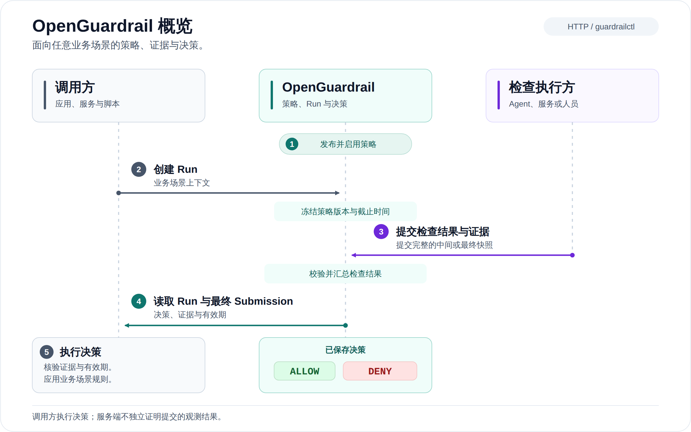

# 快速开始

页面、CLI 和管理 API 均可直接使用，无需账号或登录；提交评估仍需绑定 Run 的提交凭据。详见[访问指南](access.zh-CN.md)。

首批机器上线后，让你的 AI 编程助手按 Spec 依次排查监控、日志和告警，再决定下一批能否继续发布。[观看 30 秒回放](../media/first-batch-run.mp4)

## 跑一遍首批检查

在你的 AI 编程助手（如 Claude Code、Cursor、Codex、Antigravity 等）中打开包含 `examples/agent-demo/first_batch.py` 的仓库目录（需提前备好 Make、Python 3.9+ 及 `go.mod` 指定的 Go 版本），直接发送下面这句话：

> 用 $open-guardrail-demo 跑一遍首批检查，告诉我下一批能不能发。

Agent 会自动拉起本地临时服务，按 Spec 排查首批实例的监控、日志与告警，并在对话中给出排查过程和最终决策。默认模拟数据里，订单 `order-42` 已扣款但状态仍停留在 `pending`，预期结果为 `BLOCKED / DENY`（全程无需登录控制台）。

检查完成后，Agent 会生成一个本地 JSON 报告链接，里面保留了服务端诊断记录与采信的观测证据；哪怕随后关掉临时服务、清理了临时库和凭据，这份报告依然可以随时打开回看。如果想在 Web 控制台查看详情，在启动时告诉它开启即可。

## 评估流程

[](../images/overview.zh-CN.svg)

点击流程图可以查看完整 SVG。策略、评估和决策模型见[核心概念](concepts.zh-CN.md)。

## 前置条件

从源码运行需要：

- `go.mod` 指定的 Go 工具链。
- 执行 `make build` 所需的 Make。
- 只有运行下述本地 Demo 时，才需要 Python 3.9+。

在源码根目录运行命令。构建服务和 CLI 不需要 Node.js 或 Docker。

如果使用预览版二进制归档，先完成[归档校验](../releases.md#check-and-try-a-downloaded-archive)，再从解压根目录执行命令。用 `./open-guardrail` 和 `./guardrailctl` 替换源码构建的 `./bin/` 路径；运行二进制不需要 Go、Node.js 或 Python。

## 可选：不用模型运行文件清理

准备好 Python 3.9+ 后，在源码或归档根目录运行下列命令。从源码运行还需要 Go：

```sh
python3 examples/cleanup-demo/demo.py
```

脚本会从源码构建命令，或使用归档中的二进制，并启动可直接访问的本地服务和受控文件清理工具。首次从源码构建可能下载 Go 依赖。Demo 需要 Python 3.9+；发布组装和维护者验证脚本另需 Python 3.12+。

先打开终端输出的 **Demo** URL。清理任务和 Run 详情不需要登录。保留默认选择，点击 **Run cleanup task（运行清理任务）**：

1. Runner 请求删除全部四个示例文件，包括受保护的订单和配置文件，服务记录一个 `BLOCKED / DENY` Run。
2. Runner 将请求缩小为两个临时文件，提交新评估，服务记录一个 `PASS / ALLOW` Run。
3. 删除工具重新读取 Run 和已接受证据，核验身份与有效期，只删除批准的临时文件。
4. 在页面检查两个 Run。恢复文件、修改选择或批次上限，再次运行以比较实际结果。

检查记录时保持终端开启。Ctrl-C 停止服务，移除临时数据和凭据。原始 Recovery 契约自检命令为 `python3 examples/agent-demo/smoke.py`，默认立即退出并清理；加上 `--keep-running` 可保留记录供浏览器查看，直到按 Ctrl-C。需要持久数据或自己的策略时，使用下述操作流程。


## 接入你自己的工作流

了解 Run 的完整流转后，可以直接把 OpenGuardrail 接到日常开发或发布流程中：

- **保护 MCP 工具（Cursor / Claude Code / Cline）：** 用 `guardrailctl mcp-proxy` 包裹任意 stdio MCP Server，未命中门禁规则的普通调用零开销直通，命中规则或破坏性调用按精确参数强制举证。详见 [MCP Proxy 接入指南](../../integrations/mcp-proxy/README.md)。
- **GitHub Actions 生产发布门禁：** 直接复用复合 Action 与 3 项检查模板 `release-gate.yaml`，在生产部署前独立复验未过期的 `ALLOW` 决策。详见 [GitHub Actions 指南](../../integrations/github-actions/README.md)。

## 手动创建并检查一个 Run

### 1. 启动服务

在源码目录执行：

```sh
make build
./bin/open-guardrail serve
```

保持终端开启。默认监听 `127.0.0.1:8080`，SQLite 数据保存在相对于启动目录的 `./data/guardrail.db`。

远程或容器部署见 [Docker 部署](docker.zh-CN.md)和[访问指南](access.zh-CN.md)。

### 2. 连接 CLI

页面和 CLI 均可直接使用，无需登录：

```sh
guardrail_cli=./bin/guardrailctl
export OPEN_GUARDRAIL_URL=http://127.0.0.1:8080
umask 077
guardrail_demo_dir=$(mktemp -d)
"$guardrail_cli" status
```

私有临时目录只用于保存 Run 提交凭据。

### 3. 发布示例策略

```sh
"$guardrail_cli" scene apply --key recovery --name Recovery \
  --spec ./examples/policies/recovery.yaml --publish
```

策略编辑和发布见[场景与策略](scenes-and-specs.zh-CN.md)。

### 4. 创建 Run

创建模拟变更描述，然后创建一次评估：

```sh
cat > "$guardrail_demo_dir/change-set.json" <<'JSON'
{
  "application": "example-service",
  "environment": "local",
  "operation": "recovery"
}
JSON
guardrail_demo_operation="quickstart-$(date +%s)-$$"
"$guardrail_cli" run create \
  \
  --scene recovery \
  --change-set "$guardrail_demo_dir/change-set.json" \
  --operation-id "$guardrail_demo_operation-create" \
  --submission-credential-file "$guardrail_demo_dir/run-credential.json"
```

命令输出 `status: "OPEN"` 的 Run 对象。将其顶层 `id` 复制到以下变量，替换示例值：

```sh
guardrail_demo_run_id=run_REPLACE_WITH_RETURNED_ID
```

Run 冻结策略修订、调用方定义的 `changeSet` 和截止时间。提交凭据私密保存，CLI 不打印令牌。

在 Run 截止前完成下一步。创建结果不确定时，保留相同操作 ID，先检查状态再重试。初始凭据只返回一次，见[凭据恢复](runs.zh-CN.md)。

### 5. 提交模拟的通过评估

提交一份使用模拟观测数据、结论为通过的评估，时间戳在执行时生成：

```sh
cat > "$guardrail_demo_dir/submission.json" <<JSON
{
  "baseSubmissionNo": 0,
  "finishRun": true,
  "verdict": "PASS",
  "summary": "Synthetic local recovery assessment",
  "checks": [
    {
      "checkId": "readiness",
      "verdict": "PASS",
      "summary": "Synthetic health observation is healthy",
      "evidence": [
        {
          "requirementId": "health",
          "observedAt": "$(date -u +%Y-%m-%dT%H:%M:%SZ)",
          "querySummary": "Read a synthetic local health observation",
          "resultSummary": "Example service is healthy; no real service was queried"
        }
      ]
    }
  ]
}
JSON
"$guardrail_cli" run submit \
  --submission-credential-file "$guardrail_demo_dir/run-credential.json" \
  --submission "$guardrail_demo_dir/submission.json" \
  --operation-id "$guardrail_demo_operation-submit" \
  "$guardrail_demo_run_id"
"$guardrail_cli" run get \
  \
  "$guardrail_demo_run_id"
```

返回的 Run 应具有 `status: "FINISHED"`、`result: "PASS"`、`decision: "ALLOW"`，以及最终 Submission ID 和决策过期时间。

### 6. 检查记录

在浏览器打开 **Runs**，选择返回的 Run ID，检查冻结的策略引用、评估上下文、提交证据及决策。

真实集成必须核验权威 Run、决策有效期及其依赖的观测。见 [Run 与 Submission](runs.zh-CN.md)及[集成方案](integrations.zh-CN.md)。

## 问题排查

| 现象 | 下一步 |
| --- | --- |
| Python 版本错误 | 检查 `python3 --version`，Demo 使用 Python 3.9+。原生二进制和手动流程不需要 Python。 |
| 缺少 Go 或构建失败 | 源码需要 `go.mod` 指定的 Go 版本，并能访问公开依赖。运行 `make build` 查看编译诊断，或使用原生归档。 |
| 服务退出或未就绪 | 清理 Demo 报告安全的错误分类，并尽可能提供命令退出码。从源码运行 `./bin/open-guardrail serve`，或从归档运行 `./open-guardrail serve` 查看启动诊断，检查数据目录、原生二进制和端口。 |
| Demo 地址返回 403 | 精确打开输出的 `http://127.0.0.1:<port>`，清理 Demo 不接受 `localhost` 或其他主机名。 |
| 来不及打开 Runs，Recovery 自检就退出 | 运行 `python3 examples/agent-demo/smoke.py --keep-running` 并保持终端开启。默认 Recovery 自检会清理临时记录，清理 Demo 则会持续运行。 |

## 清理或继续探索

Ctrl-C 停止服务。从同一数据目录重启可保留 Scene、Spec 和 Run。
妥善保存 Run 提交凭据，使用完毕后删除临时凭据文件。重试与轮换规则见 [Run 指南](runs.zh-CN.md)。
